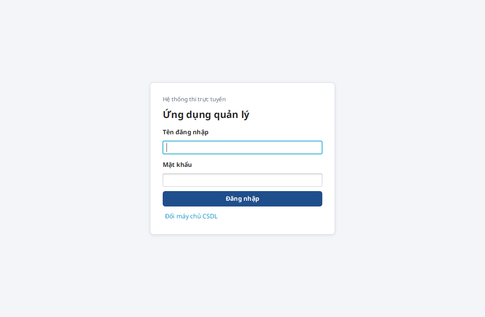
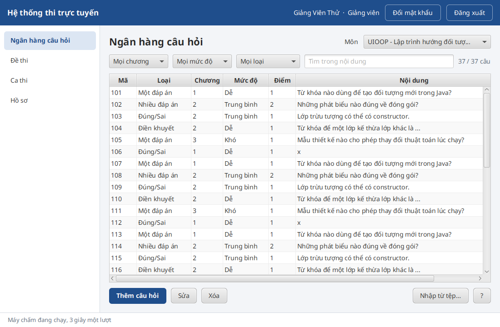
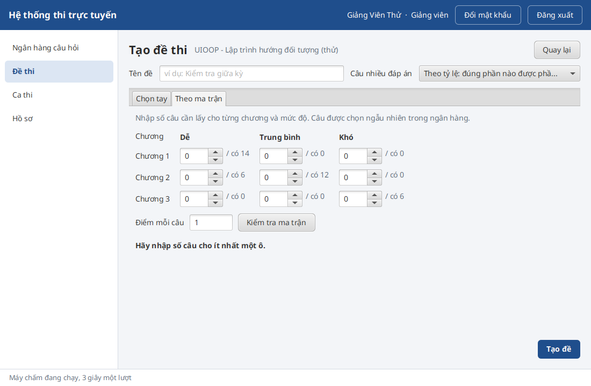
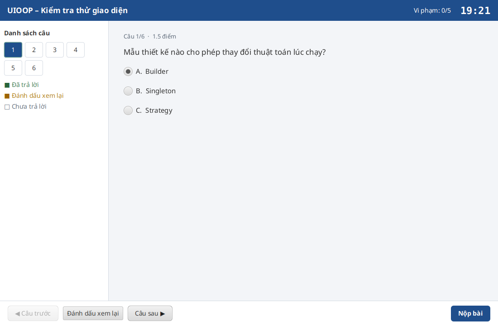
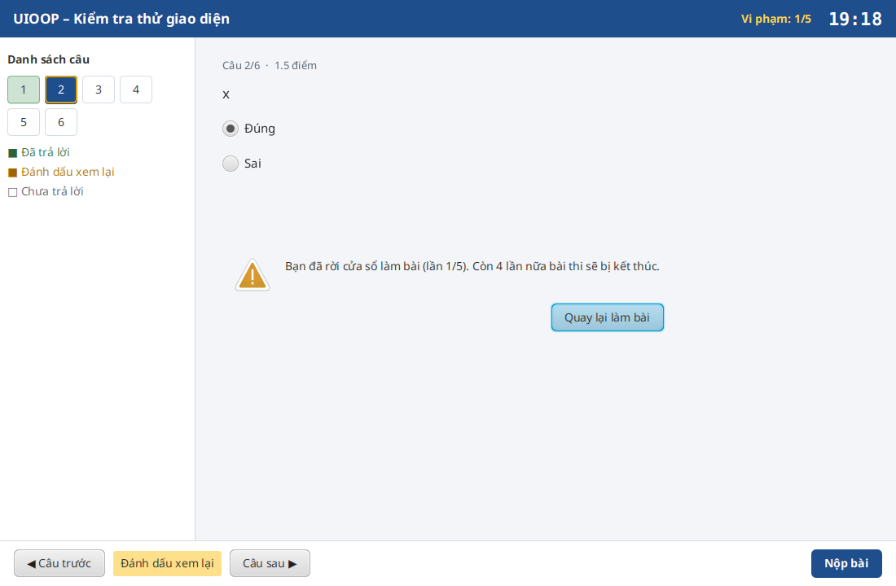
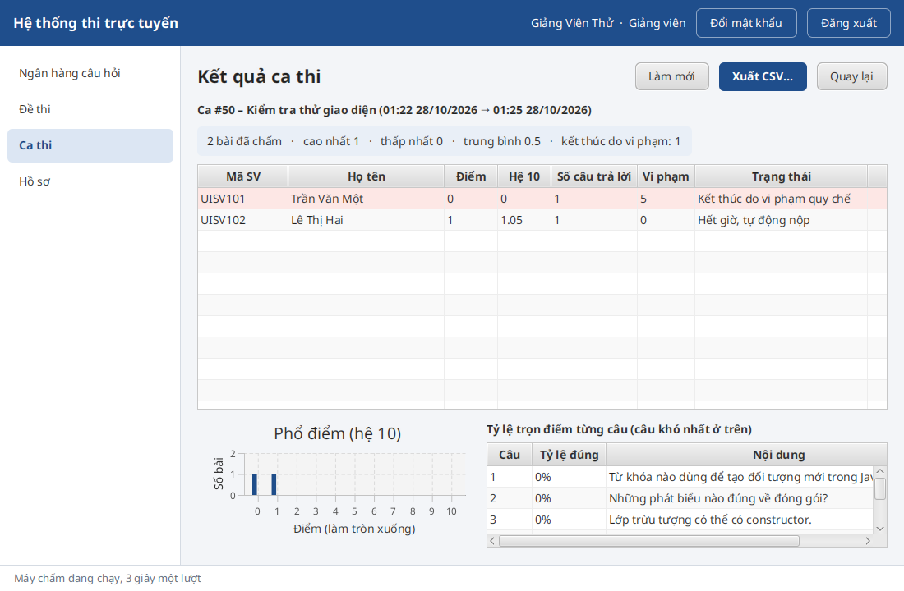
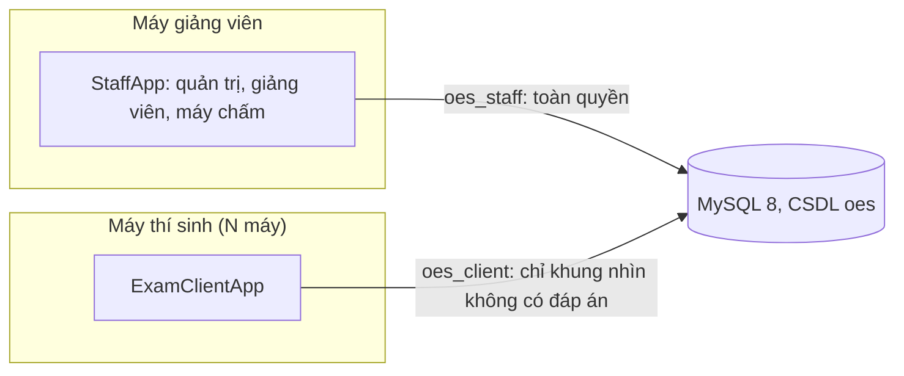

# Online Examination System – Nhóm 2

Bài tập lớn Lập trình hướng đối tượng, đề tài 16, lớp D24CQCE07-B, giảng viên Phạm Hoàng Việt.

Hệ thống thi trắc nghiệm cho phòng máy: một MySQL chung trong mạng LAN và hai ứng dụng desktop JavaFX.

- **Ứng dụng quản lý (StaffApp)**: quản trị viên quản lý người dùng, môn học, lớp, nhật ký; giảng viên quản lý ngân hàng
  câu hỏi, đề thi, ca thi, kết quả và thống kê. Khi mở, StaffApp đồng thời là máy chấm bài.
- **Ứng dụng thi (ExamClientApp)**: thí sinh xem ca thi, làm bài toàn màn hình có giám sát rời cửa sổ, xem kết quả.
  Máy thí sinh dùng tài khoản MySQL riêng nên không đọc được đáp án và không chấm bài (NFR-04).

| Đăng nhập | Ngân hàng câu hỏi | Tạo đề theo ma trận |
|---|---|---|
|  |  |  |
| **Làm bài toàn màn hình** | **Cảnh báo rời cửa sổ** | **Kết quả ca thi** |
|  |  |  |

Mục lục: [Phân công](#thành-viên-và-phân-công) · [Chạy nhanh](#chạy-nhanh) · [Tài khoản demo](#tài-khoản-demo) ·
[Tính năng](#tính-năng) · [Kiến trúc](#kiến-trúc) · [Cấu trúc mã nguồn](#cấu-trúc-mã-nguồn) · [Tài liệu](#tài-liệu) ·
[Kiểm thử](#kiểm-thử) · [Đóng gói](#đóng-gói-và-dựng-phòng-máy)

## Thành viên và phân công

Dự án chia 4 phần theo tính năng. Mỗi người nắm phần của mình qua cả ba tầng (giao diện, service, DAO, CSDL) và trả
lời vấn đáp về phần đó.

| Phần | Thành viên | MSSV | Phụ trách | Tài liệu vấn đáp | Đoạn demo |
|:-:|---|---|---|---|---|
| 1 | Đỗ Phạm Bảo Hoàng | B24DCCE098 | Người dùng, phân quyền, quản trị, khung ứng dụng | [Phần 1](docs/vandap/phan-1-nguoi-dung-quan-tri.md) | [2 phút](docs/DEMO-SCRIPT.md#phần-1--đỗ-phạm-bảo-hoàng--giới-thiệu-và-quản-trị-2-phút) |
| 2 | Đỗ Thị Vân Anh | B24DCCE007 | Ngân hàng câu hỏi và đề thi | [Phần 2](docs/vandap/phan-2-cau-hoi-de-thi.md) | [2 phút 30](docs/DEMO-SCRIPT.md#phần-2--đỗ-thị-vân-anh--giảng-viên-câu-hỏi-và-đề-thi-2-phút-30) |
| 3 | Nguyễn Hoàng Trung | B24DCCE273 | Ca thi và làm bài (máy thí sinh) | [Phần 3](docs/vandap/phan-3-ca-thi-lam-bai.md) | [3 phút](docs/DEMO-SCRIPT.md#phần-3--nguyễn-hoàng-trung--thí-sinh-làm-bài-3-phút) |
| 4 | Phan Tùng Dương | B24DCCE070 | Chấm bài, kết quả, CSDL và bảo mật | [Phần 4](docs/vandap/phan-4-cham-bai-ket-qua-csdl.md) | [2 phút 30](docs/DEMO-SCRIPT.md#phần-4--phan-tùng-dương--chấm-bài-kết-quả-bảo-mật-2-phút-30) |

Ai cũng phải đọc 14 [câu hỏi chung](docs/PHAN-CONG.md#câu-hỏi-chung--ai-cũng-phải-trả-lời-được) và mục "Quyết định
nghiệp vụ đã chốt" trong [`CLAUDE.md`](CLAUDE.md). Danh sách tệp mã của từng phần:
[Phần 1](docs/PHAN-CONG.md#phần-1--người-dùng-phân-quyền-quản-trị-khung-ứng-dụng-đỗ-phạm-bảo-hoàng) ·
[Phần 2](docs/PHAN-CONG.md#phần-2--ngân-hàng-câu-hỏi-và-đề-thi-đỗ-thị-vân-anh) ·
[Phần 3](docs/PHAN-CONG.md#phần-3--ca-thi-và-làm-bài-nguyễn-hoàng-trung) ·
[Phần 4](docs/PHAN-CONG.md#phần-4--chấm-bài-kết-quả-csdl-và-bảo-mật-phan-tùng-dương).

## Chạy nhanh

Cần JDK 17 trở lên và MySQL 8 đang chạy (hoặc Docker thay cho MySQL). Maven có sẵn qua `mvnw`, không cần cài.

| Việc | Windows (bấm đúp được) | Linux / macOS |
|---|---|---|
| Dựng CSDL, tệp cấu hình, dữ liệu mẫu (một lần) | `scripts\setup.bat` | `scripts/setup.sh` |
| Như trên, MySQL chạy trong Docker | `scripts\setup-docker.bat` | `scripts/setup-docker.sh` |
| Mở ứng dụng quản lý | `scripts\start-staff.bat` | `scripts/start-staff.sh` |
| Mở ứng dụng thi | `scripts\start-client.bat` | `scripts/start-client.sh` |
| Mở cả hai ứng dụng | `scripts\start-demo.bat` | `scripts/start-demo.sh` |
| Máy chấm không giao diện | `scripts\start-grading.bat` | `scripts/start-grading.sh` |
| Kiểm thử (thêm `--db` để chạy cả kiểm thử với MySQL) | `scripts\test.bat` | `scripts/test.sh` |

`setup` hỏi mật khẩu `root` của MySQL, tạo CSDL `oes`, ghi `db-staff.properties` và `db-client.properties` ở thư mục
dự án, tạo dữ liệu mẫu rồi in bảng tài khoản. Chi tiết, cách làm tay và lỗi thường gặp: [`docs/SETUP.md`](docs/SETUP.md).
Không cần MySQL, chỉ xem nghiệp vụ chạy trên console: `./mvnw compile exec:java` (Windows: `mvnw.cmd compile exec:java`).

Trong IntelliJ (`File → Open…`, chọn thư mục này) có sẵn các cấu hình chạy: StaffApp, ExamClientApp, ConsoleDemo,
DatabaseSetup, SeedTool, GradingDaemon, mvn test.

### Tài khoản demo

| Vai trò | Tên đăng nhập | Mật khẩu | Dùng ở |
|---|---|---|---|
| Quản trị viên | `admin` | `admin123` | StaffApp |
| Giảng viên | `gv.viet` (môn INT1332), `gv.lan` (môn INT1313) | `gv123456` | StaffApp |
| Thí sinh | 40 sinh viên lớp D24CQCE07-B ([danh sách](src/main/resources/seed-students.csv)), tên đăng nhập là mã SV viết thường, ví dụ `b24dcce098` | `sv123456` | ExamClientApp |

Ca thi mẫu mở 2 giờ kể từ lúc chạy `setup`; quá giờ thì đăng nhập `gv.viet` và mở ca mới.

## Tính năng

| Vai trò | Chức năng |
|---|---|
| Quản trị viên | Tìm, lọc, thêm, sửa, khóa tài khoản; đặt lại mật khẩu; nhập danh sách sinh viên từ CSV; môn học, lớp học phần, phân công giảng viên; xem nhật ký |
| Giảng viên | Ngân hàng câu hỏi 4 loại (một đáp án, nhiều đáp án, đúng/sai, điền khuyết), nhập từ tệp; tạo đề thủ công hoặc theo ma trận chương và mức độ; mở ca thi cho cả lớp; xem kết quả, phổ điểm, câu khó nhất; xuất CSV |
| Thí sinh | Danh sách ca thi; đọc quy chế; làm bài toàn màn hình, tự lưu từng câu, đánh dấu xem lại, đồng hồ theo giờ máy chủ; nộp bài; xem kết quả và đáp án sau khi ca đóng |
| Máy chấm | Chạy trong StaffApp (3 giây một lượt) hoặc `GradingDaemon`; đóng ca hết giờ, chấm bài đã nộp; câu nhiều đáp án chấm toàn phần hoặc theo tỷ lệ |

Quy tắc đã chốt: mỗi thí sinh thi một lần trong một ca (vào lại thì làm tiếp bài cũ); giờ mở, giờ đóng chung cho mọi
thí sinh và tính theo giờ máy chủ MySQL; rời cửa sổ làm bài là một lần vi phạm, đủ 5 lần thì bài bị kết thúc và chấm
phần đã làm, các lần cách nhau dưới 3 giây gộp làm một.

## Kiến trúc

Mỗi ứng dụng chia ba tầng: view (FXML + controller) → service (nghiệp vụ, kiểm tra quyền) → interface DAO, cài đặt bằng
JDBC cho MySQL và bằng bộ nhớ cho kiểm thử. Model dùng chung, không phụ thuộc JavaFX hay SQL.

- SOLID: `Submission` và `ExamSession` tách theo SRP; DAO tách theo người dùng (ISP); service chỉ biết interface, việc
  lắp ráp nằm trong `AppContext` và `ClientContext` (DIP).
- Mẫu thiết kế: Factory (`QuestionFactory`), Strategy (`GradingStrategy`), Template Method (`OesApplication`).

Sơ đồ CSDL (ERD), khung nhìn và phân quyền, sơ đồ lớp, máy trạng thái bài làm, sơ đồ tuần tự các luồng chính:
[`docs/DIAGRAMS.md`](docs/DIAGRAMS.md). Lý do của từng thay đổi so với thiết kế M3:
[`docs/DESIGN-CHANGES.md`](docs/DESIGN-CHANGES.md).

## Cấu trúc mã nguồn

| Thư mục | Nội dung | Phần |
|---|---|:-:|
| [`model/`](src/main/java/com/group2/oes/model) | Lớp nghiệp vụ: `User` và 3 lớp con, `Exam`, `ExamSession`, `SessionWindow`, `Submission`, `ViolationPolicy`… | 1–4 |
| [`model/question/`](src/main/java/com/group2/oes/model/question) | `Question` (lớp trừu tượng) và 4 lớp con, `AnswerOption` | 2 |
| [`client/`](src/main/java/com/group2/oes/client) | Mô hình phía máy thí sinh, không chứa đáp án: `ExamPaper`, `AttemptState`, `ServerClock`… | 3 |
| [`grading/`](src/main/java/com/group2/oes/grading) | `GradingStrategy` và 3 cách chấm, `SubmissionGrader` | 4 |
| [`factory/`](src/main/java/com/group2/oes/factory) | `QuestionFactory`, `QuestionData` | 2 |
| [`exception/`](src/main/java/com/group2/oes/exception) | `ExamAppException` và các lớp con, mỗi lỗi một mã ổn định | 1 |
| [`dao/`](src/main/java/com/group2/oes/dao) | Interface DAO; [`jdbc/`](src/main/java/com/group2/oes/dao/jdbc) cho MySQL, [`memory/`](src/main/java/com/group2/oes/dao/memory) cho kiểm thử | 1–4 |
| [`service/`](src/main/java/com/group2/oes/service) | Nghiệp vụ và kiểm tra quyền: `AuthService`, `ExamService`, `StudentExamService`, `GradingWorker`… | 1–4 |
| [`app/`](src/main/java/com/group2/oes/app) | `AppContext`, `ClientContext` (nơi lắp ráp), `ConsoleDemo`, `GradingDaemon` | 1, 4 |
| [`ui/`](src/main/java/com/group2/oes/ui) | Khung hai ứng dụng: `OesApplication`, `Navigator`, `BackgroundTasks`, `ExamProctor`, `AnswerSaver`… | 1, 3 |
| [`ui/controller/`](src/main/java/com/group2/oes/ui/controller) | Một controller cho mỗi màn hình ([`fxml/`](src/main/resources/fxml), [`css/app.css`](src/main/resources/css/app.css)) | 1–4 |
| [`tools/`](src/main/java/com/group2/oes/tools) | `DatabaseSetup`, `SqlScript` (dựng CSDL), `SeedTool` (dữ liệu mẫu) | 4, 2 |
| [`util/`](src/main/java/com/group2/oes/util) | `PasswordHasher`, `AuditLog`, `CsvLine` | 1 |
| [`db/`](db) | [`schema.sql`](db/schema.sql) (12 bảng), [`security.sql`](db/security.sql) (tài khoản, khung nhìn, quyền, trigger) | 4 |
| [`scripts/`](scripts) | Script dựng và chạy cho Windows (`.bat`) và Linux/macOS (`.sh`) | – |
| [`src/test/`](src/test/java/com/group2/oes) | 134 kiểm thử JUnit 5, `LoadSimulator`, `UiSmoke` | 1–4 |
| [`dist/`](dist) | Script chạy bản jar; jar tạo bởi `mvnw package` | – |

Gói gốc là `com.group2.oes` (`src/main/java/com/group2/oes/`).

## Tài liệu

| Tài liệu | Dùng khi |
|---|---|
| [`docs/PHAN-CONG.md`](docs/PHAN-CONG.md) | Ai phụ trách gì, tệp nào thuộc phần nào, 14 câu hỏi chung |
| [`docs/vandap/`](docs/vandap) | Tài liệu vấn đáp chi tiết của từng phần |
| [`docs/DIAGRAMS.md`](docs/DIAGRAMS.md) | Sơ đồ triển khai, ERD, phân quyền, lớp, trạng thái, tuần tự, use case |
| [`docs/SETUP.md`](docs/SETUP.md) | Chạy dự án trên máy cá nhân |
| [`docs/RUNBOOK.md`](docs/RUNBOOK.md) | Dựng phòng máy: MySQL cho LAN, phân quyền, tường lửa, sự cố thường gặp |
| [`docs/DEMO-SCRIPT.md`](docs/DEMO-SCRIPT.md) | Kịch bản demo 10 phút: bấm gì, nói gì, ai nói |
| [`docs/manual-test-checklist.md`](docs/manual-test-checklist.md) | Kiểm thử tay theo use case trước buổi bảo vệ, có các dòng bắt buộc chạy trên Windows |
| [`docs/DESIGN-CHANGES.md`](docs/DESIGN-CHANGES.md) | Mọi thay đổi so với thiết kế M3: thay đổi, lý do, ảnh hưởng |
| [`docs/PROGRESS.md`](docs/PROGRESS.md) | Tiến độ từng phase, bảng truy vết FR, câu hỏi mở |
| [`docs/load-test.md`](docs/load-test.md) | Kiểm thử tải 60 thí sinh (NFR-01, NFR-02) |
| [`docs/PLAN.md`](docs/PLAN.md) | Kế hoạch triển khai gốc |
| Báo cáo [M1](docs/Group2-Milestone1-OnlineExaminationSystem.docx), [M2](docs/Group2-Milestone2-OnlineExaminationSystem.docx), [M3](docs/Group2-Milestone3-OnlineExaminationSystem.docx), [M4](docs/Group2-Milestone4-OnlineExaminationSystem.docx) | Phân tích, thiết kế, cài đặt lõi (Word) |

## Kiểm thử

`scripts/test.sh` (Windows: `scripts\test.bat`) chạy 112 kiểm thử với DAO trong bộ nhớ, không cần MySQL.
`scripts/test.sh --db` dựng thêm CSDL riêng `oes_test` và chạy đủ 134 kiểm thử, trong đó 22 kiểm thử JDBC với MySQL
thật; 8 ca dùng chính tài khoản `oes_client` để chứng minh máy thí sinh không đọc được đáp án và không sửa được điểm.

Ngoài ra: kiểm thử tải 60 thí sinh ([`docs/load-test.md`](docs/load-test.md)) và chạy thử giao diện tự động trong Xvfb
([`UiSmoke.java`](src/test/java/com/group2/oes/ui/UiSmoke.java)).

## Đóng gói và dựng phòng máy

`./mvnw package` (Windows: `mvnw.cmd package`) tạo `dist/oes-staff.jar` và `dist/oes-client.jar`. Thư mục
[`dist/`](dist) có script `run-staff`, `run-client`, `run-grading-daemon`, `run-seed` để chạy bản jar; tệp cấu hình đặt
cạnh jar. Jar build trên hệ điều hành nào thì chỉ chạy trên hệ điều hành đó (JavaFX có phần native), nên build trên chính
máy Windows sẽ dùng. Hướng dẫn đầy đủ: [`docs/RUNBOOK.md`](docs/RUNBOOK.md).

## Công nghệ

Java 17, JavaFX 21 (FXML + CSS), JDBC thuần với MySQL Connector/J, Maven, JUnit 5. Theo ràng buộc của giảng viên, không
dùng framework nào khác.
