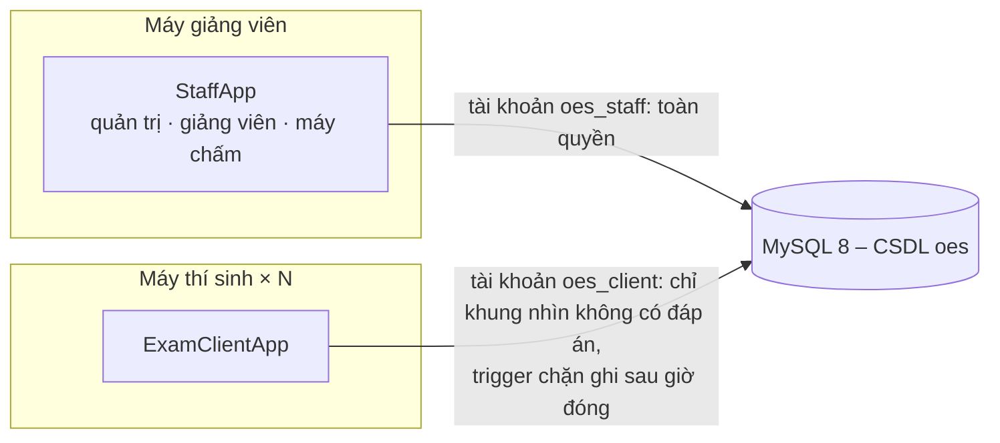
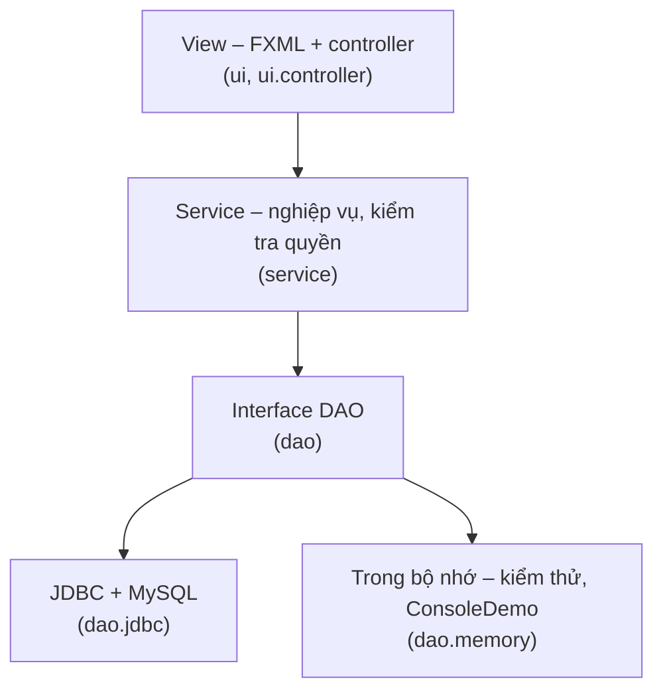

# Online Examination System – Nhóm 2


Bài tập lớn **Lập trình hướng đối tượng** – đề tài 16, lớp D24CQCE07-B, giảng viên Phạm Hoàng Việt.

Hệ thống thi trắc nghiệm cho phòng máy: **một MySQL chung trong mạng LAN** và **hai ứng dụng desktop JavaFX**.

- **Ứng dụng quản lý (StaffApp)**: quản trị viên quản lý người dùng, môn học, lớp và nhật ký. Giảng viên quản lý ngân
  hàng câu hỏi, đề thi, ca thi, kết quả và thống kê. Khi mở, StaffApp đồng thời là **máy chấm bài**.
- **Ứng dụng thi (ExamClientApp)**: thí sinh xem ca thi, làm bài toàn màn hình có giám sát rời cửa sổ, xem kết quả.
  Máy thí sinh dùng tài khoản MySQL riêng nên **không đọc được đáp án** và không chấm bài (NFR-04).

| Đăng nhập | Ngân hàng câu hỏi | Tạo đề theo ma trận |
|---|---|---|
|  |  |  |
| **Làm bài toàn màn hình** | **Cảnh báo rời cửa sổ** | **Kết quả ca thi** |
|  |  |  |

**Mục lục:** [Phân công](#thành-viên-và-phân-công) · [Bắt đầu nhanh](#bắt-đầu-nhanh) ·
[Tài khoản demo](#tài-khoản-demo) · [Tính năng](#tính-năng) · [Kiến trúc](#kiến-trúc) ·
[Cấu trúc mã nguồn](#cấu-trúc-mã-nguồn) · [Tài liệu](#tài-liệu) · [Kiểm thử](#kiểm-thử) · [Đóng gói](#đóng-gói-và-dựng-phòng-máy)

---

## Thành viên và phân công

Dự án chia **4 phần theo tính năng**. Mỗi người nắm trọn phần của mình qua cả ba tầng: giao diện → service → DAO → CSDL,
và trả lời vấn đáp về phần đó. Bấm vào tên tài liệu để đọc.

| Phần | Thành viên | MSSV | Phụ trách | Tài liệu vấn đáp | Đoạn demo |
|:-:|---|---|---|---|---|
| **1** | **Đỗ Phạm Bảo Hoàng** | B24DCCE098 | Người dùng, phân quyền, quản trị, khung ứng dụng | 📘 [Phần 1 – Người dùng, quản trị](docs/vandap/phan-1-nguoi-dung-quan-tri.md) | [Giới thiệu và quản trị · 2 phút](docs/DEMO-SCRIPT.md#phần-1--đỗ-phạm-bảo-hoàng--giới-thiệu-và-quản-trị-2-phút) |
| **2** | **Đỗ Thị Vân Anh** | B24DCCE007 | Ngân hàng câu hỏi và đề thi | 📗 [Phần 2 – Câu hỏi, đề thi](docs/vandap/phan-2-cau-hoi-de-thi.md) | [Câu hỏi và đề thi · 2 phút 30](docs/DEMO-SCRIPT.md#phần-2--đỗ-thị-vân-anh--giảng-viên-câu-hỏi-và-đề-thi-2-phút-30) |
| **3** | **Nguyễn Hoàng Trung** | B24DCCE273 | Ca thi và làm bài (máy thí sinh) | 📙 [Phần 3 – Ca thi, làm bài](docs/vandap/phan-3-ca-thi-lam-bai.md) | [Thí sinh làm bài · 3 phút](docs/DEMO-SCRIPT.md#phần-3--nguyễn-hoàng-trung--thí-sinh-làm-bài-3-phút) |
| **4** | **Phan Tùng Dương** | B24DCCE070 | Chấm bài, kết quả, CSDL và bảo mật | 📕 [Phần 4 – Chấm bài, CSDL](docs/vandap/phan-4-cham-bai-ket-qua-csdl.md) | [Chấm bài, bảo mật · 2 phút 30](docs/DEMO-SCRIPT.md#phần-4--phan-tùng-dương--chấm-bài-kết-quả-bảo-mật-2-phút-30) |

**Ai cũng phải đọc:** 14 [câu hỏi chung](docs/PHAN-CONG.md#câu-hỏi-chung--ai-cũng-phải-trả-lời-được) (ba tầng, SOLID,
mẫu thiết kế, luồng JavaFX, xử lý lỗi…) và mục "Quyết định nghiệp vụ đã chốt" trong [`CLAUDE.md`](CLAUDE.md).

Mỗi phần gồm những tệp mã nào: [Phần 1](docs/PHAN-CONG.md#phần-1--người-dùng-phân-quyền-quản-trị-khung-ứng-dụng-đỗ-phạm-bảo-hoàng) ·
[Phần 2](docs/PHAN-CONG.md#phần-2--ngân-hàng-câu-hỏi-và-đề-thi-đỗ-thị-vân-anh) ·
[Phần 3](docs/PHAN-CONG.md#phần-3--ca-thi-và-làm-bài-nguyễn-hoàng-trung) ·
[Phần 4](docs/PHAN-CONG.md#phần-4--chấm-bài-kết-quả-csdl-và-bảo-mật-phan-tùng-dương)
(trong [`docs/PHAN-CONG.md`](docs/PHAN-CONG.md)).

Mỗi tài liệu vấn đáp có cùng 17 mục: nói trong 1 phút → phạm vi → ranh giới với phần khác → thứ tự đọc mã → kiến thức
nền → từng lớp kèm mã trích → luồng chạy tới câu SQL → CSDL → quy tắc nghiệp vụ → SOLID và mẫu thiết kế → khác với M3/M4
→ kiểm thử → giới hạn → đoạn demo → 30–35 câu hỏi vấn đáp → thuật ngữ → checklist tự kiểm tra.

---

## Bắt đầu nhanh

| Bạn muốn | Làm gì |
|---|---|
| Xem nghiệp vụ chạy ngay, **không cần cài MySQL** | `./mvnw compile exec:java` (Windows: `mvnw.cmd compile exec:java`), hoặc cấu hình **ConsoleDemo** trong IntelliJ |
| **Chạy đủ hai ứng dụng** trên máy mình (lần đầu) | Làm theo 📄 [`docs/SETUP.md`](docs/SETUP.md): cài MySQL, tạo CSDL, dữ liệu mẫu, mở hai ứng dụng (khoảng 30 phút) |
| **Dựng phòng máy** cho buổi thi/demo thật | Làm theo 📄 [`docs/RUNBOOK.md`](docs/RUNBOOK.md): MySQL cho LAN, phân quyền, tường lửa, jar |
| Chuẩn bị **buổi demo 10 phút** | 📄 [`docs/DEMO-SCRIPT.md`](docs/DEMO-SCRIPT.md) và 📄 [`docs/manual-test-checklist.md`](docs/manual-test-checklist.md) |

Chỉ cần **JDK 17 trở lên**; Maven có sẵn qua `./mvnw`. Mở trong IntelliJ: `File → Open…` chọn thư mục này. Các cấu hình
chạy có sẵn ở góc trên bên phải:

| Cấu hình | Việc |
|---|---|
| StaffApp (quản lý) | `mvn javafx:run@staff` |
| ExamClientApp (thi) | `mvn javafx:run@client` |
| ConsoleDemo | Toàn bộ kịch bản nghiệp vụ trên console, dữ liệu trong bộ nhớ |
| SeedTool (dữ liệu mẫu) | Tạo dữ liệu demo, đọc `db-staff.properties` |
| GradingDaemon (máy chấm) | Máy chấm không giao diện, đọc `db-staff.properties` |
| mvn test / Tất cả kiểm thử | Chạy kiểm thử |

Tệp cấu hình `db-staff.properties`, `db-client.properties` đặt ở **thư mục dự án** (mẫu trong [`config/`](config/)).
Chưa có tệp thì ứng dụng hiện màn hình nhập địa chỉ máy chủ và tự lưu.

### Tài khoản demo

Tạo bởi SeedTool ([`docs/SETUP.md` bước 5](docs/SETUP.md#5-dữ-liệu-mẫu)):

| Vai trò | Tên đăng nhập | Mật khẩu | Dùng ở |
|---|---|---|---|
| Quản trị viên | `admin` | `admin123` | StaffApp |
| Giảng viên | `gv.viet` (môn INT1332), `gv.lan` (môn INT1313) | `gv123456` | StaffApp |
| Thí sinh | `b24dcce001` … `b24dcce060`, và 4 thành viên nhóm theo MSSV (ví dụ `b24dcce098`) | `sv123456` | ExamClientApp |

Ca thi mẫu mở **2 giờ** kể từ lúc chạy SeedTool; quá giờ thì đăng nhập `gv.viet` và mở ca mới.

---

## Tính năng

| Vai trò | Chức năng |
|---|---|
| Quản trị viên | Tìm, lọc, thêm, sửa, khóa tài khoản; đặt lại mật khẩu; nhập danh sách sinh viên từ CSV; môn học, lớp học phần, phân công giảng viên; xem nhật ký |
| Giảng viên | Ngân hàng câu hỏi 4 loại (một đáp án, nhiều đáp án, đúng/sai, điền khuyết), nhập từ tệp; tạo đề thủ công hoặc **theo ma trận** chương × mức độ; mở ca thi cho cả lớp; xem kết quả, phổ điểm, câu khó nhất; xuất CSV |
| Thí sinh | Danh sách ca thi; đọc quy chế; làm bài **toàn màn hình**, tự lưu từng câu, đánh dấu xem lại, đồng hồ theo giờ máy chủ; nộp bài; xem kết quả và đáp án sau khi ca đóng |
| Máy chấm | Chạy trong StaffApp (3 giây một lượt) hoặc `GradingDaemon`; đóng ca hết giờ, chấm bài đã nộp; câu nhiều đáp án chấm toàn phần hoặc theo tỷ lệ |

Các quy tắc đã chốt:
- Mỗi thí sinh thi **một lần** trong một ca; thoát ra vào lại thì làm tiếp bài cũ.
- Giờ mở và giờ đóng ca là chung cho mọi thí sinh; giờ tính theo **máy chủ MySQL**, không theo máy trạm.
- Rời cửa sổ làm bài là một lần vi phạm. **Đủ 5 lần** thì bài bị kết thúc, chấm phần đã làm. Các lần cách nhau dưới 3 giây
  được gộp làm một.
- Mất mạng giữa giờ: hiện dải báo vàng, có mạng lại thì tự lưu.

Chi tiết: [`CLAUDE.md`](CLAUDE.md).

---

## Kiến trúc



Mỗi ứng dụng chia ba tầng; lớp model dùng chung, không phụ thuộc JavaFX hay SQL:



Nguyên lý và mẫu thiết kế chính:
- **SOLID**: `Submission` và `ExamSession` được tách theo SRP; interface DAO tách theo người dùng (ISP); service chỉ biết
  interface, việc lắp ráp nằm trong `AppContext` và `ClientContext` (DIP).
- **Mẫu thiết kế**: Factory (`QuestionFactory`), Strategy (`GradingStrategy`), Template Method (`OesApplication`).

Lý do của từng thay đổi so với thiết kế M3: [`docs/DESIGN-CHANGES.md`](docs/DESIGN-CHANGES.md).

## Cấu trúc mã nguồn

| Thư mục | Nội dung | Phần |
|---|---|:-:|
| [`model/`](src/main/java/com/group2/oes/model) | Lớp nghiệp vụ: `User` và 3 lớp con, `Exam`, `ExamSession`, `SessionWindow`, `Submission`, `ViolationPolicy`… | 1–4 |
| [`model/question/`](src/main/java/com/group2/oes/model/question) | `Question` (lớp trừu tượng) và 4 lớp con, `AnswerOption` | 2 |
| [`client/`](src/main/java/com/group2/oes/client) | Mô hình phía máy thí sinh, **không chứa đáp án**: `ExamPaper`, `AttemptState`, `ServerClock`… | 3 |
| [`grading/`](src/main/java/com/group2/oes/grading) | `GradingStrategy` và 3 cách chấm (mẫu Strategy), `SubmissionGrader` | 4 |
| [`factory/`](src/main/java/com/group2/oes/factory) | `QuestionFactory`, `QuestionData` (mẫu Factory) | 2 |
| [`exception/`](src/main/java/com/group2/oes/exception) | `ExamAppException` và các lớp con, mỗi lỗi một mã ổn định | 1 |
| [`dao/`](src/main/java/com/group2/oes/dao) | Interface DAO tách theo người dùng; [`jdbc/`](src/main/java/com/group2/oes/dao/jdbc) cho MySQL, [`memory/`](src/main/java/com/group2/oes/dao/memory) cho kiểm thử | 1–4 |
| [`service/`](src/main/java/com/group2/oes/service) | Nghiệp vụ và kiểm tra quyền: `AuthService`, `ExamService`, `StudentExamService`, `GradingWorker`… | 1–4 |
| [`app/`](src/main/java/com/group2/oes/app) | `AppContext`, `ClientContext` (nơi lắp ráp), `ConsoleDemo`, `GradingDaemon` | 1, 4 |
| [`ui/`](src/main/java/com/group2/oes/ui) | Khung hai ứng dụng: `OesApplication`, `Navigator`, `BackgroundTasks`, `ExamProctor`, `AnswerSaver`… | 1, 3 |
| [`ui/controller/`](src/main/java/com/group2/oes/ui/controller) | Một controller cho mỗi màn hình ([`fxml/`](src/main/resources/fxml), [`css/app.css`](src/main/resources/css/app.css)) | 1–4 |
| [`tools/`](src/main/java/com/group2/oes/tools), [`util/`](src/main/java/com/group2/oes/util) | `SeedTool`; `PasswordHasher`, `AuditLog`, `CsvLine` | 2, 1 |
| [`db/`](db) | [`schema.sql`](db/schema.sql) (12 bảng), [`security.sql`](db/security.sql) (tài khoản, khung nhìn, quyền, trigger) | 4 |
| [`src/test/`](src/test/java/com/group2/oes) | 126 kiểm thử JUnit 5, `LoadSimulator`, `UiSmoke` | 1–4 |
| [`dist/`](dist) | Script `run-*.bat` / `.sh`; jar tạo bởi `mvnw package` | – |

Gói gốc là `com.group2.oes` (`src/main/java/com/group2/oes/`). Cột "Phần" cho biết thư mục thuộc phần phụ trách nào.

---

## Tài liệu

| Tài liệu | Dùng khi |
|---|---|
| 👥 [`docs/PHAN-CONG.md`](docs/PHAN-CONG.md) | Ai phụ trách gì, tệp nào thuộc phần nào, 14 câu hỏi chung |
| 📘📗📙📕 [`docs/vandap/`](docs/vandap) | Tài liệu vấn đáp chi tiết của từng phần ([bảng phân công](#thành-viên-và-phân-công)) |
| 🛠 [`docs/SETUP.md`](docs/SETUP.md) | Chạy dự án trên máy cá nhân, từ cài đặt tới đăng nhập |
| 🏫 [`docs/RUNBOOK.md`](docs/RUNBOOK.md) | Dựng phòng máy: MySQL cho LAN, phân quyền, tường lửa, sự cố thường gặp |
| 🎬 [`docs/DEMO-SCRIPT.md`](docs/DEMO-SCRIPT.md) | Kịch bản demo 10 phút: bấm gì, nói gì, ai nói |
| ✅ [`docs/manual-test-checklist.md`](docs/manual-test-checklist.md) | Kiểm thử tay theo use case trước buổi bảo vệ (có các dòng bắt buộc chạy trên Windows) |
| 🔀 [`docs/DESIGN-CHANGES.md`](docs/DESIGN-CHANGES.md) | Mọi thay đổi so với thiết kế M3: thay đổi – lý do – ảnh hưởng |
| 📈 [`docs/PROGRESS.md`](docs/PROGRESS.md) | Tiến độ từng phase, bảng truy vết FR, câu hỏi mở cần nhóm xác nhận |
| ⏱ [`docs/load-test.md`](docs/load-test.md) | Kiểm thử tải 60 thí sinh (NFR-01, NFR-02) |
| 🗺 [`docs/PLAN.md`](docs/PLAN.md) | Kế hoạch triển khai gốc |
| 📄 [Báo cáo M1](docs/Group2-Milestone1-OnlineExaminationSystem.docx) · [M2](docs/Group2-Milestone2-OnlineExaminationSystem.docx) · [M3](docs/Group2-Milestone3-OnlineExaminationSystem.docx) · [M4](docs/Group2-Milestone4-OnlineExaminationSystem.docx) | Phân tích, thiết kế, cài đặt lõi (bản Word) |

---

## Kiểm thử

```bash
./mvnw test
```

Lệnh trên chạy **104 kiểm thử** với DAO trong bộ nhớ, không cần MySQL.

Thêm **22 kiểm thử JDBC** chạy với MySQL thật, trong đó 8 ca dùng chính tài khoản `oes_client` để chứng minh máy thí sinh
không đọc được đáp án và không sửa được điểm. Các ca này chạy khi đặt hai biến môi trường trỏ tới tệp cấu hình của một CSDL
thử (cách tạo: [`docs/SETUP.md` bước 8](docs/SETUP.md#8-tùy-chọn-kiểm-thử-với-mysql-thật)):

```bash
OES_TEST_DB=test-staff.properties OES_TEST_DB_CLIENT=test-client.properties ./mvnw test
```

Ngoài ra còn có:
- kiểm thử tải 60 thí sinh: [`docs/load-test.md`](docs/load-test.md);
- chạy thử giao diện tự động trong Xvfb: [`UiSmoke.java`](src/test/java/com/group2/oes/ui/UiSmoke.java).

## Đóng gói và dựng phòng máy

```bash
./mvnw package          # tạo dist/oes-staff.jar, dist/oes-client.jar
```

Thư mục [`dist/`](dist) có script `run-staff`, `run-client`, `run-grading-daemon`, `run-seed` (`.bat` cho Windows, `.sh`
cho Linux/macOS). Tệp cấu hình đặt cạnh jar.

**Jar build trên hệ điều hành nào thì chỉ chạy trên hệ điều hành đó**, vì JavaFX có phần native. Hãy build trên chính máy
Windows sẽ dùng. Hướng dẫn đầy đủ: [`docs/RUNBOOK.md`](docs/RUNBOOK.md).

## Công nghệ

Java 17, JavaFX 21 (FXML + CSS), JDBC thuần với MySQL Connector/J, Maven, JUnit 5. Theo ràng buộc của giảng viên, dự án
không dùng framework nào khác: không Spring, không Hibernate.
