# Sơ đồ kỹ thuật

[README](../README.md) · [Phân công](PHAN-CONG.md) · [Tài liệu vấn đáp](vandap/) · [Chạy trên máy cá nhân](SETUP.md) · [Dựng phòng máy](RUNBOOK.md) · [Kịch bản demo](DEMO-SCRIPT.md)

Bộ sơ đồ vẽ bằng Mermaid, GitHub tự hiển thị. Tên bảng, cột, lớp, phương thức lấy đúng từ mã nguồn hiện tại; mã đổi thì
sửa sơ đồ theo. Sơ đồ trong README là bản rút gọn của mục [Triển khai](#triển-khai). Mỗi mục ghi rõ thuộc phần nào trong [PHAN-CONG.md](PHAN-CONG.md).

Ký hiệu trong sơ đồ lớp: `+` public, `-` private, `#` protected, `~` package-private, `$` static, `*` abstract.
Đường dẫn tắt `oes/` là `src/main/java/com/group2/oes/`.

## Mục lục

- [Triển khai](#triển-khai) – phần 4, phần 1
- [Cơ sở dữ liệu](#cơ-sở-dữ-liệu) – phần 4
  - [ERD tổng thể](#erd-tổng-thể)
  - [ERD cụm người dùng và môn học](#erd-cụm-người-dùng-và-môn-học) – phần 1
  - [ERD cụm câu hỏi và đề thi](#erd-cụm-câu-hỏi-và-đề-thi) – phần 2
  - [ERD cụm ca thi và bài làm](#erd-cụm-ca-thi-và-bài-làm) – phần 3, phần 4
- [Khung nhìn và phân quyền](#khung-nhìn-và-phân-quyền) – phần 4
- [Kiến trúc tầng và gói](#kiến-trúc-tầng-và-gói) – phần 1
- [Sơ đồ lớp](#sơ-đồ-lớp)
  - [Người dùng và phân quyền](#người-dùng-và-phân-quyền) – phần 1
  - [Câu hỏi và Factory](#câu-hỏi-và-factory) – phần 2
  - [Đề thi, ma trận, ngân hàng](#đề-thi-ma-trận-ngân-hàng) – phần 2
  - [Ca thi và quy chế](#ca-thi-và-quy-chế) – phần 3
  - [Bài làm và chấm điểm](#bài-làm-và-chấm-điểm) – phần 4
  - [DAO tách theo người dùng](#dao-tách-theo-người-dùng) – phần 1, 3, 4
  - [Mô hình phía máy thí sinh](#mô-hình-phía-máy-thí-sinh) – phần 3
  - [Khung giao diện](#khung-giao-diện) – phần 1
- [Máy trạng thái bài làm](#máy-trạng-thái-bài-làm) – phần 3, phần 4
- [Sơ đồ tuần tự](#sơ-đồ-tuần-tự)
  - [Đăng nhập trên máy thí sinh](#đăng-nhập-trên-máy-thí-sinh) – phần 1
  - [Vào thi](#vào-thi) – phần 3
  - [Trả lời và tự lưu](#trả-lời-và-tự-lưu) – phần 3
  - [Rời cửa sổ và vi phạm](#rời-cửa-sổ-và-vi-phạm) – phần 3
  - [Nộp bài](#nộp-bài) – phần 3
  - [Máy chấm chấm bài](#máy-chấm-chấm-bài) – phần 4
  - [Sinh đề theo ma trận](#sinh-đề-theo-ma-trận) – phần 2
  - [Mở ca thi](#mở-ca-thi) – phần 3
- [Use case tổng quát](#use-case-tổng-quát) – cả bốn phần

---

## Triển khai

Thuộc phần 4 (CSDL, tài khoản MySQL, máy chấm) và phần 1 (khung hai ứng dụng). Không có máy chủ ứng dụng ở giữa: mỗi
ứng dụng nối thẳng vào MySQL bằng JDBC, khác nhau ở tài khoản MySQL dùng để kết nối.

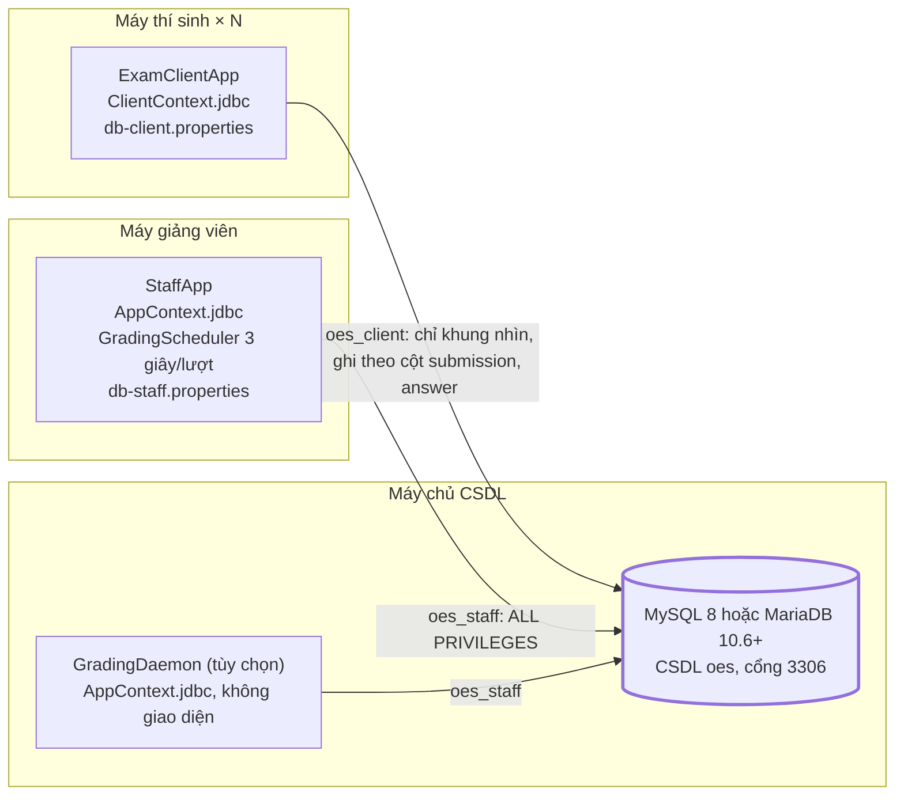

- Hai tài khoản tạo trong [db/security.sql](../db/security.sql): `oes_staff` có `GRANT ALL PRIVILEGES ON *` (mọi
  bảng của CSDL đang chọn); `oes_client` chỉ đọc 4 khung nhìn và 2 bảng cấu hình ca, ghi được một số cột của
  `submission`, `answer`, gọi được `sp_student_change_password`. Chi tiết ở
  [Khung nhìn và phân quyền](#khung-nhìn-và-phân-quyền).
- Vì sao hai tài khoản: tệp `db-client.properties` nằm trên mọi máy trạm, ai cũng đọc được mật khẩu `oes_client`.
  Quyền phải đặt ở MySQL chứ không ở mã ứng dụng, để ứng dụng thi bị sửa cũng không đọc được đáp án (NFR-04).
- Máy chấm là `GradingWorker`, chạy trong StaffApp (`StaffApp.onConnected` khởi động `GradingScheduler`) hoặc trong
  `GradingDaemon` khi không có máy giảng viên nào mở StaffApp. Hai máy chấm chạy cùng lúc vẫn an toàn vì
  `JdbcGradingDao.saveGrades` chỉ ghi khi bài còn `SUBMITTED`.
- Giờ chuẩn luôn là `SELECT NOW()` của MySQL (`serverTime()` trong các DAO). Máy thí sinh giữ `ServerClock`, đồng bộ
  lại 60 giây một lần, không dùng đồng hồ máy trạm để tính giờ thi.
- Trong phòng máy thường gộp máy giảng viên và máy chủ CSDL làm một ([RUNBOOK.md](RUNBOOK.md)).
- Nguồn: [oes/ui/StaffApp.java](../src/main/java/com/group2/oes/ui/StaffApp.java),
  [oes/ui/ExamClientApp.java](../src/main/java/com/group2/oes/ui/ExamClientApp.java),
  [oes/app/GradingDaemon.java](../src/main/java/com/group2/oes/app/GradingDaemon.java),
  [oes/ui/AppConfig.java](../src/main/java/com/group2/oes/ui/AppConfig.java).

---

## Cơ sở dữ liệu

Thuộc phần 4 (toàn bộ `db/schema.sql`); mỗi cụm bảng do người phụ trách tính năng tương ứng giải thích. 12 bảng,
khóa chính tự tăng trừ bốn bảng dùng khóa ghép (`instructor_subject`, `exam_item`, `session_student`, `answer`).

### ERD tổng thể

Chỉ có bảng và quan hệ; cột đầy đủ ở ba sơ đồ cụm bên dưới. Nhãn trên đường nối là cột khóa ngoại.
`||--o{` là một–nhiều (bắt buộc ở phía một), `|o--o{` là khóa ngoại cho phép NULL.

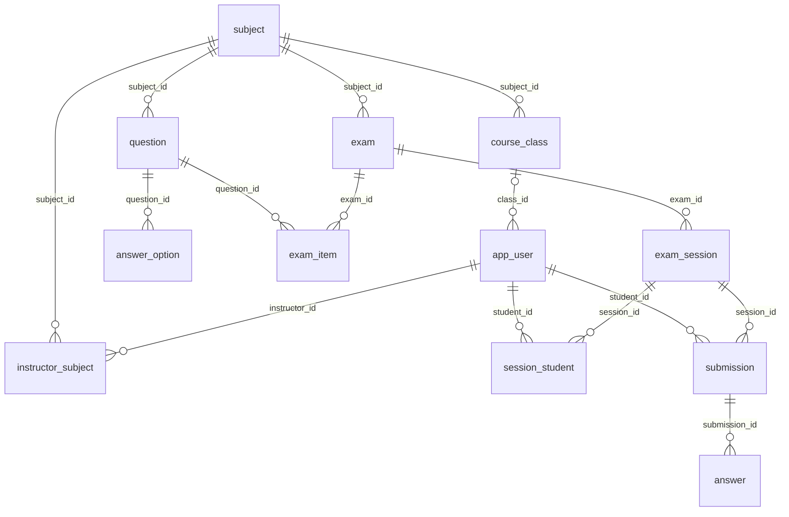

- Không có khóa ngoại từ `answer` sang `exam_item`: `answer.item_order` là số câu gốc trong đề, ghép với
  `exam_item` qua `submission.session_id → exam_session.exam_id`. Thêm khóa ngoại ghép `(exam_id, item_order)` thì
  `answer` phải mang thêm `exam_id`, trùng với thông tin đã có.
- `ON DELETE CASCADE` chỉ có ở bốn chỗ "con không sống được nếu thiếu cha": `answer_option`, `exam_item`,
  `session_student`, `answer`. `submission` không có `ON DELETE CASCADE`, nên ca thi đã có bài làm thì khóa ngoại
  chặn việc xóa ca.
- Nguồn: [db/schema.sql](../db/schema.sql).

### ERD cụm người dùng và môn học

Bốn bảng của phần 1. Ba vai trò dùng chung một bảng `app_user` (single-table), cột `role` quyết định lớp con khi
đọc lên (`JdbcUserDao.mapUser`).

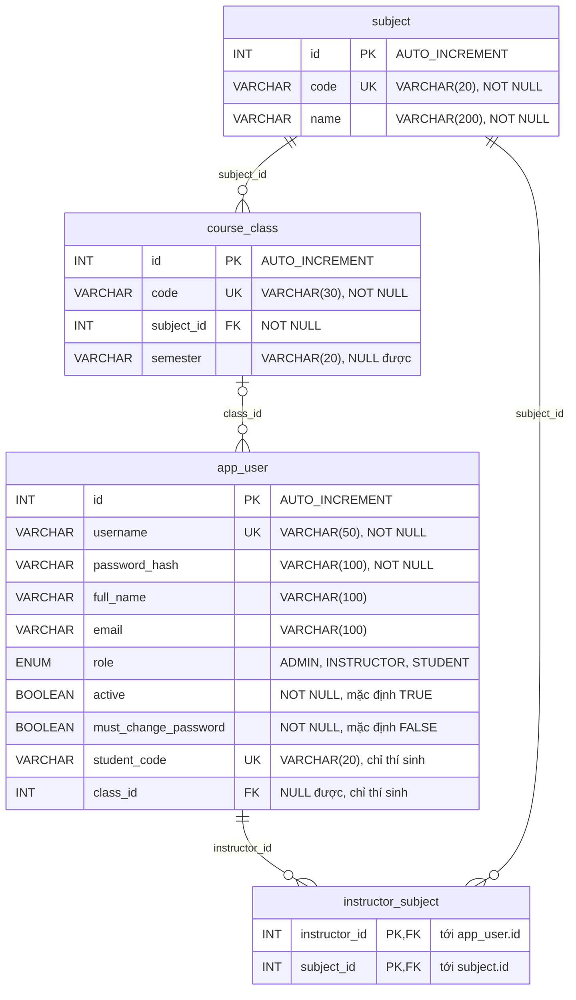

- Tên bảng là `app_user`, không phải `user`, để khỏi nhầm với bảng hệ thống `mysql.user`.
- Single-table cho ba vai trò: ba lớp con chỉ khác nhau hai cột (`student_code`, `class_id`), tách ba bảng thì đăng
  nhập phải tra ba nơi. Cột không thuộc vai trò để NULL; `UNIQUE` của MySQL cho nhiều dòng NULL nên `student_code`
  vẫn đặt được `UNIQUE`.
- `instructor_subject` là bảng nối nhiều–nhiều, ánh xạ `Instructor.subjects` (`Instructor.canManage` dựa vào đây).
- `must_change_password` bật cho tài khoản nhập từ CSV; thí sinh đổi mật khẩu qua thủ tục
  `sp_student_change_password` vì `oes_client` không có quyền `UPDATE app_user`.
- Nguồn: [db/schema.sql](../db/schema.sql),
  [oes/dao/jdbc/JdbcUserDao.java](../src/main/java/com/group2/oes/dao/jdbc/JdbcUserDao.java).

### ERD cụm câu hỏi và đề thi

Bốn bảng của phần 2. Bảng ngoài cụm (`subject`) vẽ thành hộp rỗng; cột của nó ở cụm người dùng và môn học.

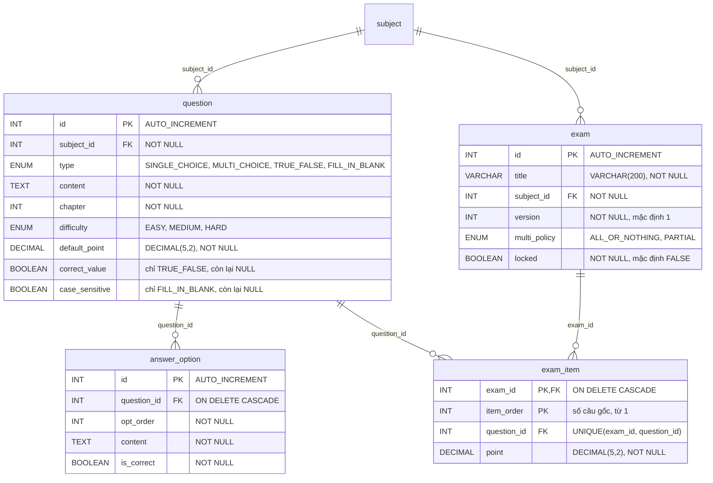

- Bốn loại câu hỏi dùng chung một bảng `question`; cột riêng của từng loại (`correct_value`, `case_sensitive`) để
  NULL ở loại khác. `QuestionFactory.create` dựng đúng lớp con theo cột `type`.
- `answer_option` chứa cả phương án trắc nghiệm lẫn đáp án chấp nhận của câu điền khuyết (`is_correct = TRUE`). Vì
  thế khung nhìn `v_exam_paper` chỉ lấy phương án của câu `SINGLE_CHOICE`, `MULTI_CHOICE`.
- `UNIQUE(exam_id, question_id)` chặn một câu xuất hiện hai lần trong một đề, khớp với `Exam.addItem`
  (`DUPLICATE_QUESTION`).
- `exam.locked` và `exam.version` hiện thực BR-09: đề đã có ca thi thì khóa, muốn sửa phải tạo phiên bản mới
  (`Exam.newVersion`).
- Chỉ mục `idx_question_pick (subject_id, chapter, difficulty)` phục vụ việc lọc câu theo chương và mức độ.
- Nguồn: [db/schema.sql](../db/schema.sql).

### ERD cụm ca thi và bài làm

`exam_session`, `session_student` thuộc phần 3; `submission`, `answer` thuộc phần 4. `exam` và `app_user` là bảng
ngoài cụm.

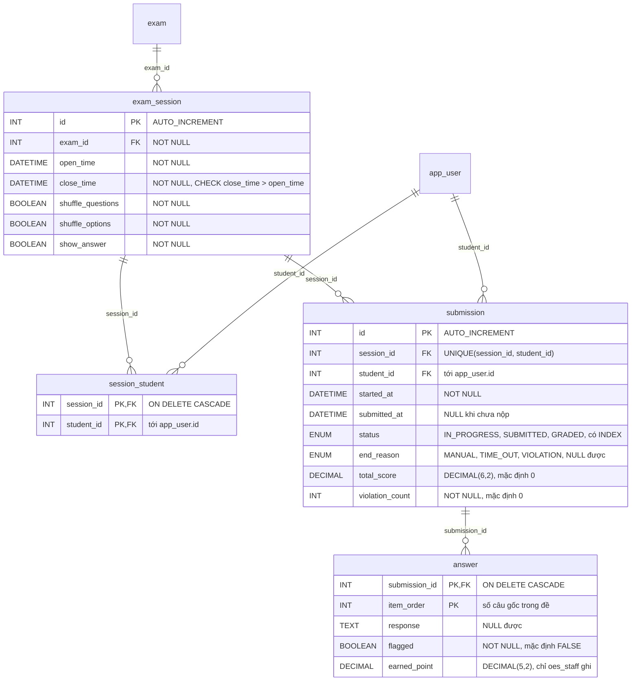

- `UNIQUE(session_id, student_id)` trên `submission` là chốt chặn cuối của quy tắc "mỗi thí sinh thi một lần": hai
  máy cùng bấm "Vào thi" thì chỉ một `INSERT` đi qua, máy kia nhận `DuplicateKeyException` và mở lại bài vừa tạo
  (`StudentExamService.create`).
- Giờ mở, giờ đóng nằm ở `exam_session`, chung cho mọi thí sinh; không có cột thời lượng riêng từng người. Vào muộn
  thì còn ít thời gian hơn.
- Câu trả lời lưu theo `item_order` gốc, không theo thứ tự đã trộn: thứ tự trộn tính lại được từ
  `PaperShuffler.seedFor(sessionId, studentId)` nên không cần lưu.
- Chỉ mục `idx_submission_status` vì máy chấm tìm bài `SUBMITTED` mỗi 3 giây.
- `earned_point` và `total_score` không nằm trong danh sách cột `oes_client` được ghi, nên máy thí sinh không tự cho
  mình điểm được.
- Nguồn: [db/schema.sql](../db/schema.sql).

---

## Khung nhìn và phân quyền

Thuộc phần 4 (`db/security.sql`); `v_login` liên quan phần 1, `v_session_for_student` và `v_exam_paper` liên quan
phần 3. Sơ đồ thứ nhất cho thấy mỗi khung nhìn lấy từ bảng nào và lọc gì; sơ đồ thứ hai cho thấy `oes_client` được
chạm vào đâu.

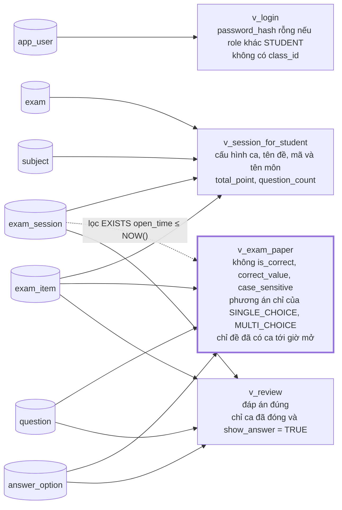

| Khung nhìn | Cột trả ra | Không trả ra |
|---|---|---|
| `v_login` | `id, username, password_hash, full_name, email, role, active, must_change_password, student_code` | `class_id`; mã băm của quản trị viên, giảng viên (thay bằng chuỗi rỗng) |
| `v_session_for_student` | `session_id, exam_id, open_time, close_time, shuffle_questions, shuffle_options, show_answer, exam_title, subject_code, subject_name, total_point, question_count` | – |
| `v_exam_paper` | `exam_id, item_order, point, question_id, type, content, option_id, opt_order, option_content` | `answer_option.is_correct`, `question.correct_value`, `question.case_sensitive`, đáp án điền khuyết; cả đề nếu chưa có ca nào tới giờ mở |
| `v_review` | `session_id, item_order, type, correct_value, correct_option_id, accepted_answer` | mọi dòng, khi ca chưa đóng hoặc `show_answer = FALSE` |

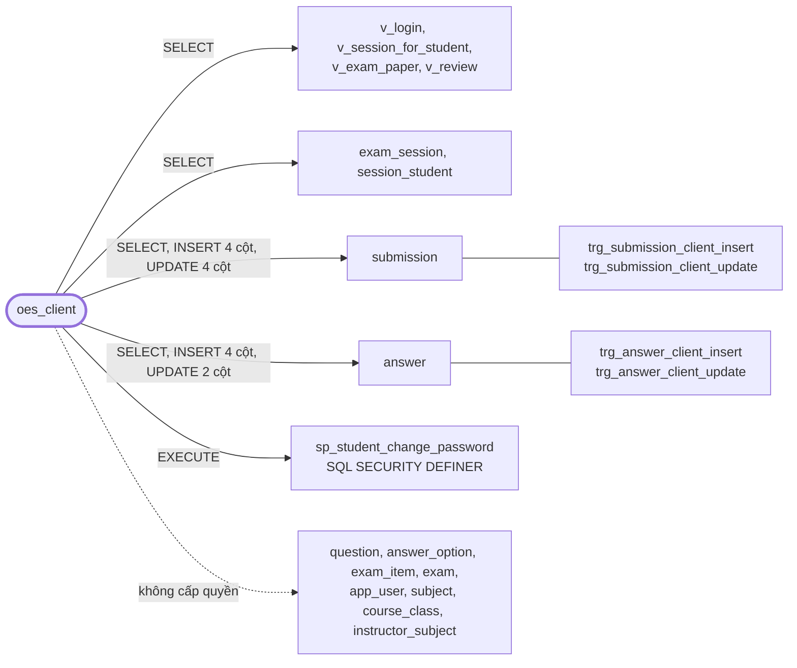

| Đối tượng | Quyền của `oes_client` |
|---|---|
| `submission` | `SELECT`; `INSERT (session_id, student_id, started_at, status)`; `UPDATE (status, submitted_at, end_reason, violation_count)`. Không ghi được `total_score`. |
| `answer` | `SELECT`; `INSERT (submission_id, item_order, response, flagged)`; `UPDATE (response, flagged)`. Không ghi được `earned_point`. |

| Trigger | Lúc chạy | Chặn gì (chỉ khi `USER()` là `oes_client`) |
|---|---|---|
| `trg_submission_client_insert` | `BEFORE INSERT ON submission` | Bài mới có `status` khác `IN_PROGRESS` |
| `trg_submission_client_update` | `BEFORE UPDATE ON submission` | Sửa bài đã khỏi `IN_PROGRESS`; đặt `status = 'GRADED'`; giảm `violation_count` |
| `trg_answer_client_insert` | `BEFORE INSERT ON answer` | Ghi khi bài không còn `IN_PROGRESS` hoặc ca đã qua `close_time` (giờ máy chủ) |
| `trg_answer_client_update` | `BEFORE UPDATE ON answer` | Như trên; `INSERT ... ON DUPLICATE KEY UPDATE` đi qua cả hai trigger |

- Khung nhìn chạy với quyền người tạo (`SQL SECURITY DEFINER` mặc định), nên `oes_client` đọc được dữ liệu đã lọc mà
  không cần quyền trên `question`, `answer_option`. `SELECT` thẳng vào hai bảng này bị MySQL từ chối, kể cả khi mã
  ứng dụng thi bị sửa.
- Quyền theo cột chặn được "ghi cột nào" nhưng không chặn được "ghi giá trị gì" (ví dụ tự đặt `status = 'GRADED'`,
  ghi câu trả lời sau giờ đóng). Bốn trigger là lưới an toàn cho phần đó.
- Trong trigger phải dùng `USER()` (người đang kết nối), không dùng `CURRENT_USER()` (người tạo trigger). Lệnh của
  `oes_staff` không bị chặn, nên máy chấm vẫn đóng ca và ghi điểm được.
- Trigger báo lỗi bằng `SQLSTATE '45000'`, thông điệp bắt đầu bằng `SUBMISSION_LOCKED`; `JdbcErrors.translate` đổi
  thành `SessionRuleException(SUBMISSION_LOCKED)`, tầng trên xử lý như lỗi nghiệp vụ.
- `v_review` chặt hơn "xem sau khi nộp": thí sinh nộp sớm không được thấy đáp án trong lúc người khác còn thi.
- Giới hạn còn lại: mọi máy thí sinh dùng chung `oes_client`, nên ứng dụng bị sửa vẫn đọc, ghi được câu trả lời của
  thí sinh khác (không đọc được đáp án, không sửa được điểm).
- Nguồn: [db/security.sql](../db/security.sql),
  [oes/dao/jdbc/JdbcErrors.java](../src/main/java/com/group2/oes/dao/jdbc/JdbcErrors.java).

---

## Kiến trúc tầng và gói

Thuộc phần 1. Mũi tên liền là "gọi tới"; mũi tên đứt là "cài đặt interface" hoặc "tạo đối tượng". Các gói trong khung
dưới cùng dùng chung cho mọi tầng.

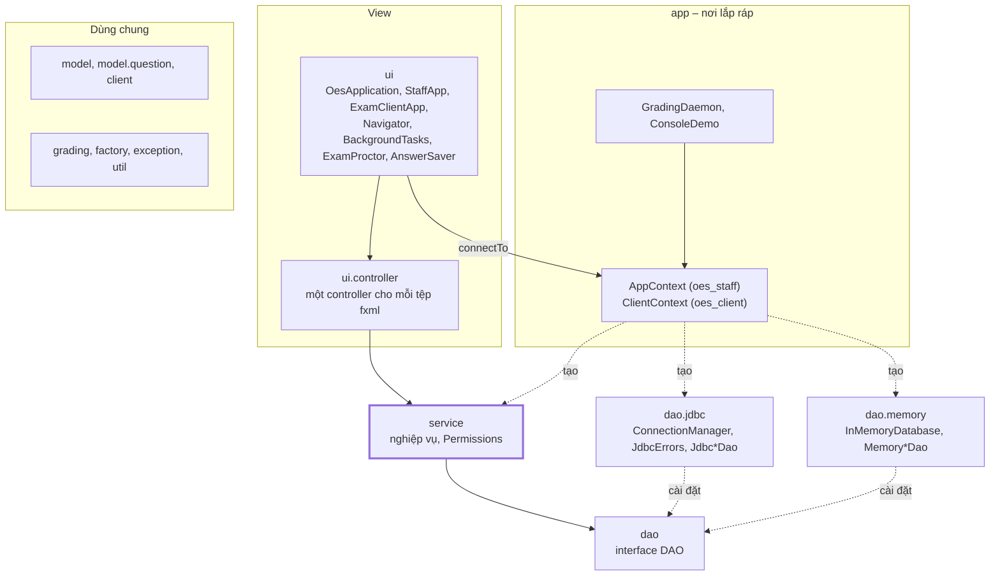

- Service chỉ biết interface DAO, nhận qua constructor (DIP). Lệnh `new` cho service và DAO chỉ nằm trong
  `AppContext.jdbc` / `AppContext.inMemory` và `ClientContext.jdbc` / `ClientContext.inMemory`.
- Controller lấy service từ context được truyền vào (`ws.app().examService`, `client.exams`), gọi qua
  `BackgroundTasks.run` để không chặn luồng giao diện. Controller không có logic nghiệp vụ và không thấy DAO.
- `ClientContext` chỉ có `StudentLoginDao` và `StudentExamDao`: ứng dụng thi không có đối tượng nào đọc được đáp án,
  kể cả khi cấu hình nhầm tài khoản nhiều quyền hơn.
- `dao.memory` dùng cho kiểm thử JUnit và `ConsoleDemo`, không cần MySQL. Các lớp `Memory*Dao` là package-private, chỉ
  lấy được qua `InMemoryDatabase`.
- Model không import `javafx.*` và không chứa SQL. Lưu ý: `Exam` giữ bảng `QuestionType → GradingStrategy`
  (`Exam.strategyFor`), nên `model` và `grading` tham chiếu lẫn nhau.
- `exception`: `ExamAppException` (trừu tượng) với các lớp con `ValidationException`, `AccessDeniedException`,
  `SessionRuleException`, `DataAccessException`, và `DuplicateKeyException` kế thừa `DataAccessException`.
- Nguồn: [oes/app/AppContext.java](../src/main/java/com/group2/oes/app/AppContext.java),
  [oes/app/ClientContext.java](../src/main/java/com/group2/oes/app/ClientContext.java).

---

## Sơ đồ lớp

Mỗi cụm một sơ đồ, chỉ ghi thuộc tính và phương thức quan trọng; getter, setter, `toString` bỏ qua.

### Người dùng và phân quyền

Thuộc phần 1. `User` trừu tượng với hai phương thức trừu tượng; mỗi lớp con trả lời `canManage` theo cách riêng (đa
hình, LSP). `Permissions` gom các kiểm tra vai trò và quyền theo môn mà service gọi ở đầu mỗi thao tác.

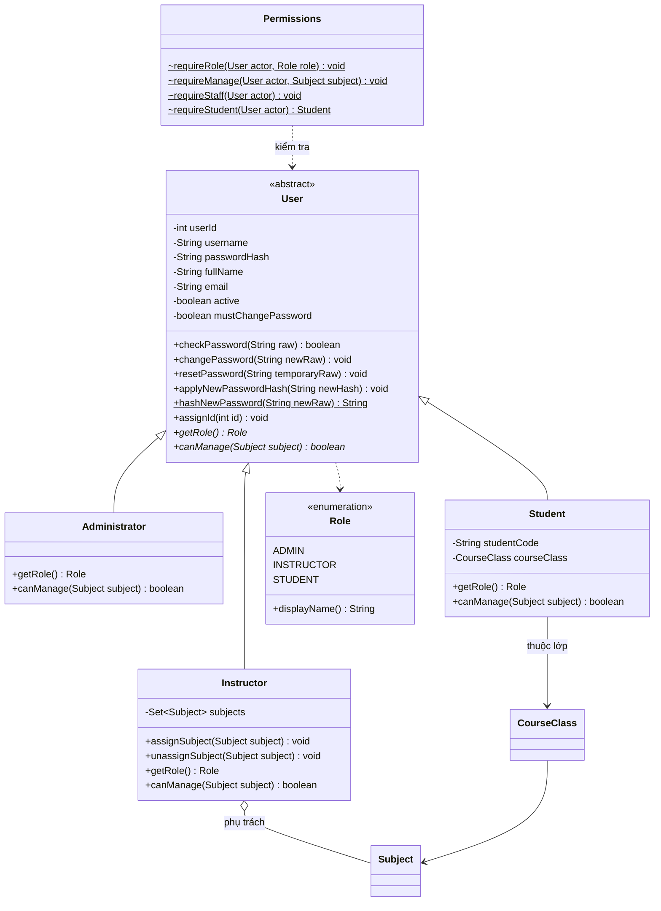

- `canManage`: `Administrator` luôn `true`, `Instructor` khi môn nằm trong `subjects`, `Student` luôn `false`.
  `Permissions.requireManage` chỉ gọi `actor.canManage(subject)`, không hỏi "đây là lớp nào".
- `Permissions` là lớp `final` package-private trong `service`: controller không gọi được, nên mọi kiểm tra quyền
  buộc phải đi qua service, kể cả khi giao diện đã ẩn nút.
- `requireStudent` dùng pattern matching `instanceof` và trả về luôn `Student`, đỡ một lần ép kiểu ở nơi gọi.
- `assignId` chỉ gán một lần (ném `IllegalStateException` nếu đã có mã); `equals`, `hashCode` theo `userId`.
- Nguồn: [oes/model/User.java](../src/main/java/com/group2/oes/model/User.java),
  [oes/service/Permissions.java](../src/main/java/com/group2/oes/service/Permissions.java).

### Câu hỏi và Factory

Thuộc phần 2. Mỗi loại câu hỏi tự kiểm tra dữ liệu trong constructor và tự trả lời `isCorrect`, `correctRatio`.
`QuestionFactory` là chỗ duy nhất chọn lớp con theo `QuestionType` (mẫu Factory).

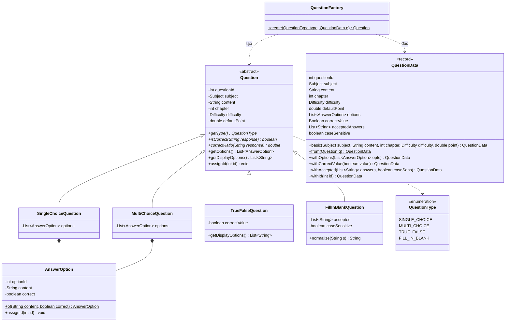

- Bốn lớp con đều ghi đè `getType`, `isCorrect`, `correctRatio`; hai lớp trắc nghiệm ghi đè thêm `getOptions`.
  Thêm loại câu hỏi mới là thêm một lớp con và một nhánh `case` (OCP).
- `QuestionFactory.create` dùng `switch` trên enum: thiếu nhánh thì trình biên dịch báo lỗi. Câu đúng/sai thiếu
  `correctValue` bị chặn ngay trong factory (`TF_NEEDS_VALUE`).
- `QuestionData` là record mang mọi trường có thể có; trường không dùng với loại đang tạo để `null`. Nhờ vậy form
  giao diện, đọc tệp nhập và `JdbcQuestionDao` cùng tạo câu hỏi qua một đường.
- `correctRatio` của `MultiChoiceQuestion` là tỷ lệ đúng trừ phần chọn sai, dùng khi đề cấu hình `PARTIAL`.
- Nguồn: [oes/model/question/](../src/main/java/com/group2/oes/model/question),
  [oes/factory/QuestionFactory.java](../src/main/java/com/group2/oes/factory/QuestionFactory.java),
  [oes/factory/QuestionData.java](../src/main/java/com/group2/oes/factory/QuestionData.java).

### Đề thi, ma trận, ngân hàng

Thuộc phần 2. `Exam` sở hữu danh sách `ExamItem` (mỗi câu một mức điểm riêng trong đề) và chọn cách chấm cho từng
loại câu. `QuestionBank` gom câu hỏi của một môn, bốc câu theo `ExamMatrix`.

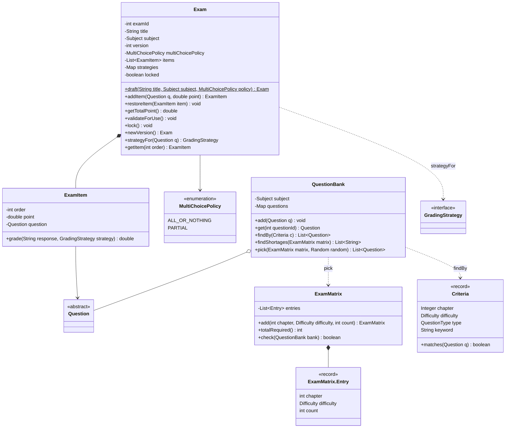

- Bảng chiến lược chấm dựng trong constructor của `Exam`: `SINGLE_CHOICE`, `TRUE_FALSE` dùng `ExactMatchGrading`;
  `FILL_IN_BLANK` dùng `TextMatchGrading`; `MULTI_CHOICE` dùng `PartialMatchGrading` nếu `PARTIAL`, ngược lại
  `ExactMatchGrading`.
- `addItem` gọi `ensureEditable` (đề khóa thì `EXAM_LOCKED`), kiểm tra câu đúng môn (`WRONG_SUBJECT`) và không trùng
  (`DUPLICATE_QUESTION`). `validateForUse` chặn đề rỗng hoặc tổng điểm 0 (BR-11).
- `QuestionBank.pick` gọi `findShortages` trước: thiếu câu ở ô nào của ma trận thì ném `BANK_SHORTAGE` kèm danh
  sách ô thiếu, không sinh đề thiếu câu. Mỗi ô được trộn bằng `Collections.shuffle` với `Random` truyền vào, nên kiểm
  thử truyền `Random` có seed cố định.
- `ExamMatrix.add` chặn hai dòng cùng chương và mức độ (`MATRIX_DUPLICATE`); `Entry` chặn số câu không dương.
- Nguồn: [oes/model/Exam.java](../src/main/java/com/group2/oes/model/Exam.java),
  [oes/model/ExamMatrix.java](../src/main/java/com/group2/oes/model/ExamMatrix.java),
  [oes/model/QuestionBank.java](../src/main/java/com/group2/oes/model/QuestionBank.java).

### Ca thi và quy chế

Thuộc phần 3. `ExamSession` ghép đề, khung giờ và cấu hình trộn; hai giá trị sau là record bất biến. Quy chế vi phạm
nằm riêng ở `ViolationPolicy`, `ProctoringService` chỉ điều phối.

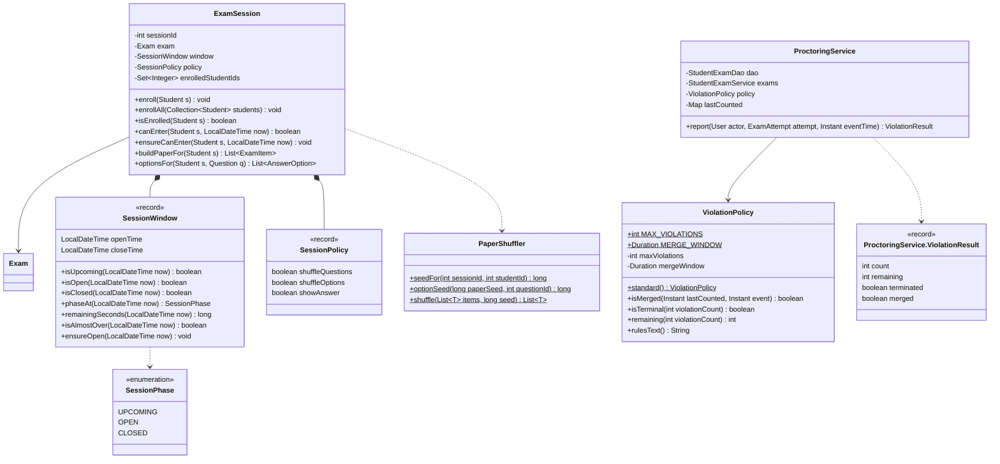

- `SessionWindow` kiểm tra `closeTime` sau `openTime` trong compact constructor (`SESSION_TIME`), nên không tồn tại
  một khung giờ sai. Khoảng `[openTime, closeTime)`: đúng giờ đóng là đã đóng. `ALMOST_OVER` là 5 phút.
- `ensureOpen` ném `SessionRuleException` với mã `SESSION_NOT_OPEN_YET` hoặc `SESSION_CLOSED`; `now` luôn là giờ máy
  chủ truyền vào, lớp này không tự đọc đồng hồ.
- Trộn đề tất định: seed là `Objects.hash(sessionId, studentId)`, seed phương án là `paperSeed * 31 + questionId`.
  Thoát ra vào lại vẫn thấy đúng thứ tự cũ mà không phải lưu thứ tự. Máy thí sinh trộn bằng `ExamPaper.shuffledFor`
  với cùng `PaperShuffler` và cùng seed.
- `ViolationPolicy.standard()` là 5 lần, gộp trong 3 giây. `isMerged` so với lần được tính gần nhất, không so với lần
  rời cửa sổ gần nhất.
- Nguồn: [oes/model/ExamSession.java](../src/main/java/com/group2/oes/model/ExamSession.java),
  [oes/model/SessionWindow.java](../src/main/java/com/group2/oes/model/SessionWindow.java),
  [oes/model/PaperShuffler.java](../src/main/java/com/group2/oes/model/PaperShuffler.java),
  [oes/model/ViolationPolicy.java](../src/main/java/com/group2/oes/model/ViolationPolicy.java),
  [oes/service/ProctoringService.java](../src/main/java/com/group2/oes/service/ProctoringService.java).

### Bài làm và chấm điểm

Thuộc phần 4. `Submission` chỉ giữ dữ liệu và chuyển trạng thái; việc chấm nằm ở `SubmissionGrader`, cách chấm từng
câu nằm ở các lớp `GradingStrategy` (mẫu Strategy). Lớp này chỉ dùng phía máy chấm, máy thí sinh dùng `AttemptState`.

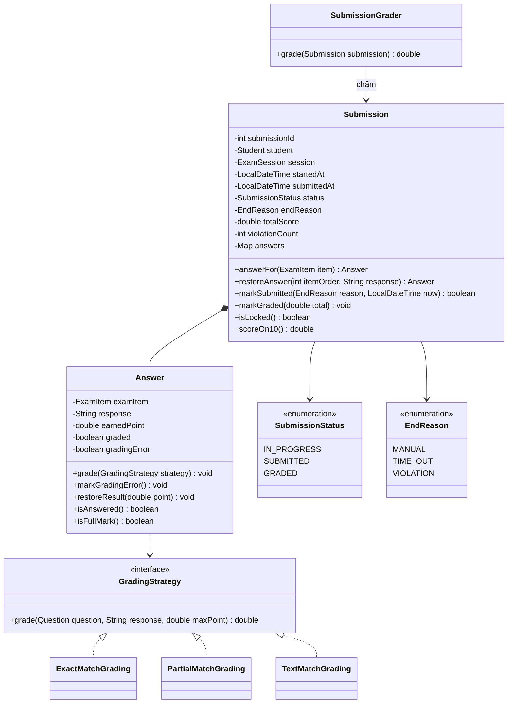

- `ExactMatchGrading`: `isCorrect` thì đủ điểm, không thì 0. `PartialMatchGrading`: `correctRatio` chặn trong
  `[0, 1]` nhân điểm câu, làm tròn 2 chữ số. `TextMatchGrading`: chỉ nhận `FillInBlankQuestion`, sai loại thì ném
  `WRONG_STRATEGY`.
- `SubmissionGrader.grade` duyệt mọi câu của đề (cả câu bỏ trống, qua `answerFor`), lấy chiến lược bằng
  `Exam.strategyFor`. Một câu ném lỗi thì `markGradingError` (0 điểm, ghi log) rồi chấm tiếp câu khác, cả bài không hỏng.
- `markSubmitted` trả `false` nếu bài đã khóa (nộp lần hai giữ lần đầu); `markGraded` chỉ nhận bài `SUBMITTED`.
- `violationCount` là `final` trong `Submission`: phía máy chấm chỉ đọc số vi phạm, việc tăng nằm ở
  `StudentExamDao.increaseViolation`.
- Nguồn: [oes/model/Submission.java](../src/main/java/com/group2/oes/model/Submission.java),
  [oes/model/Answer.java](../src/main/java/com/group2/oes/model/Answer.java),
  [oes/grading/](../src/main/java/com/group2/oes/grading).

### DAO tách theo người dùng

Thuộc phần 1 (đăng nhập), phần 3 (`StudentExamDao`), phần 4 (`GradingDao`). Cùng một bảng nhưng mỗi phía có interface
riêng, chỉ chứa đúng những thao tác phía đó cần (ISP). Hai sơ đồ: phía đăng nhập và phía bài làm.

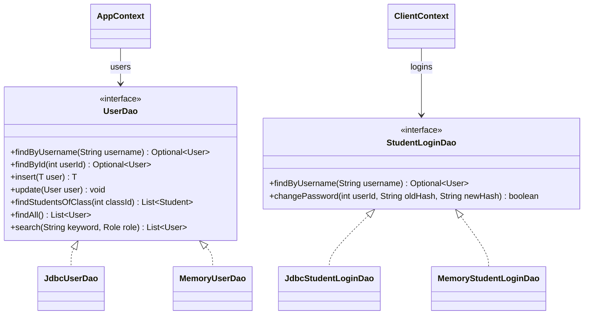

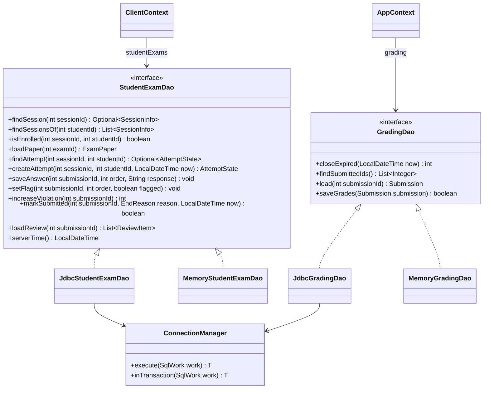

| Interface | Cài đặt JDBC | Cài đặt bộ nhớ | Ai dùng | Context |
|---|---|---|---|---|
| `UserDao` | `JdbcUserDao` | `MemoryUserDao` | `AuthService`, `UserImportService`, `ExamSessionService` | `AppContext` |
| `SubjectDao` | `JdbcSubjectDao` | `MemorySubjectDao` | `AuthService`, `UserImportService`, `SubjectService` | `AppContext` |
| `QuestionDao` | `JdbcQuestionDao` | `MemoryQuestionDao` | `QuestionBankService` | `AppContext` |
| `ExamDao` | `JdbcExamDao` | `MemoryExamDao` | `ExamService`, `ExamSessionService` | `AppContext` |
| `ExamSessionDao` | `JdbcExamSessionDao` | `MemorySessionDao` | `ExamSessionService`, `GradingWorker` | `AppContext` |
| `SubmissionDao` | `JdbcSubmissionDao` | `MemorySubmissionDao` | `StatisticsService` | `AppContext` |
| `GradingDao` | `JdbcGradingDao` | `MemoryGradingDao` | `GradingWorker` | `AppContext` |
| `StudentLoginDao` | `JdbcStudentLoginDao` | `MemoryStudentLoginDao` | `StudentAuthService` | `ClientContext` |
| `StudentExamDao` | `JdbcStudentExamDao` | `MemoryStudentExamDao` | `StudentExamService`, `ProctoringService` | `ClientContext` |

- `StudentLoginDao` không có `insert`, `update`: ứng dụng thi không thể gọi nhầm hàm sửa người dùng.
  `JdbcStudentLoginDao` đọc `v_login` và đổi mật khẩu bằng `CALL sp_student_change_password`.
- `StudentExamDao` không có hàm đọc đáp án hay ghi điểm; `GradingDao` không có ở `ClientContext`. Nhìn kiểu dữ liệu là
  biết máy thí sinh làm được gì.
- `JdbcStudentExamDao` chỉ dùng `v_session_for_student`, `v_exam_paper`, `v_review`, `exam_session`, `session_student`,
  `submission`, `answer`. `JdbcGradingDao` chạy bằng `oes_staff`, nhận thêm `ExamSessionDao` để dựng lại `ExamSession` khi `load`.
- `ConnectionManager.execute` đổi `SQLException` thành ngoại lệ của hệ thống qua `JdbcErrors`; `inTransaction` dùng
  cho thao tác nhiều câu lệnh (`saveGrades`, `JdbcExamDao.insert`, `JdbcExamSessionDao.insert`).
- Nguồn: [oes/dao/](../src/main/java/com/group2/oes/dao),
  [oes/dao/jdbc/](../src/main/java/com/group2/oes/dao/jdbc),
  [oes/dao/memory/](../src/main/java/com/group2/oes/dao/memory).

### Mô hình phía máy thí sinh

Thuộc phần 3. Gói `client` là mô hình riêng của ứng dụng thi, dựng từ khung nhìn nên không có trường nào chứa đáp án
đúng. Chỉ `ReviewItem.correctAnswer` có đáp án, và chỉ khi `v_review` trả dòng.

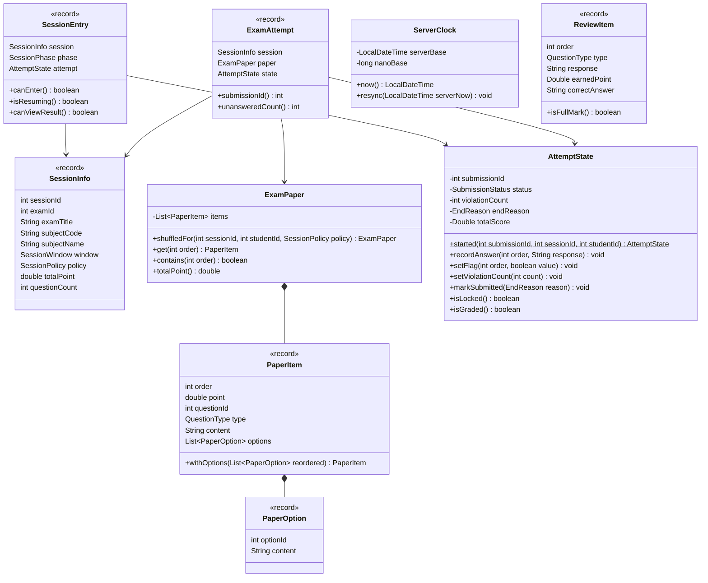

- So với `model`: `PaperItem` thay cho `ExamItem` + `Question`, `PaperOption` thay cho `AnswerOption` nhưng không có
  `correct`; `AttemptState` thay cho `Submission` nhưng không chấm được.
- `AttemptState.totalScore` là `Double` (có thể `null`): chỉ có giá trị khi bài đã `GRADED`. Các phương thức
  `synchronized` vì luồng giao diện và luồng nền cùng đọc, ghi.
- `ServerClock.now()` = giờ máy chủ lúc đồng bộ + thời gian trôi đo bằng `System.nanoTime()`; thí sinh chỉnh giờ máy
  trạm không ảnh hưởng.
- Bỏ khỏi sơ đồ cho gọn: `AnswerSheet` (trạng thái câu trả lời trên màn hình), `AnswerFormat` (ghép, tách mã phương
  án trong `response`).
- Nguồn: [oes/client/](../src/main/java/com/group2/oes/client).

### Khung giao diện

Thuộc phần 1. `OesApplication.start` cố định thứ tự khởi động; hai lớp con chỉ điền các bước khác nhau (mẫu Template
Method). `AppShell` là giao diện chung mà màn hình đăng nhập, đổi mật khẩu, cài đặt máy chủ dùng cho cả hai ứng dụng.

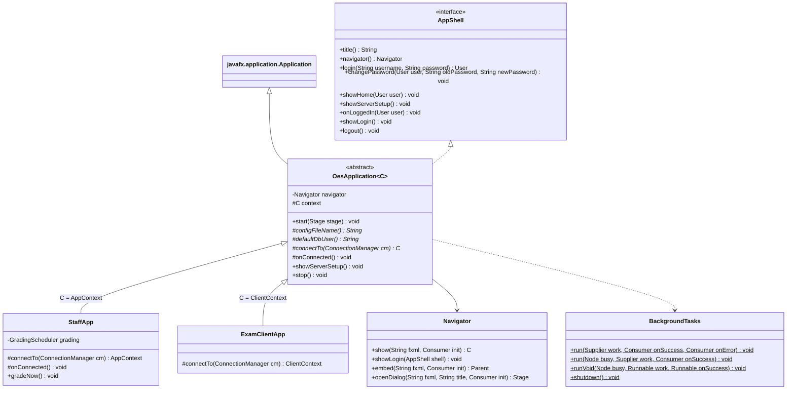

- `start` là `final`: kết nối CSDL trên luồng nền → màn hình đăng nhập; không có tệp cấu hình hoặc không kết nối được
  thì hiện `server-setup.fxml`. Lớp con chỉ cài `configFileName`, `defaultDbUser`, `connectTo`, `login`,
  `changePassword`, `showHome`; `StaffApp` cài thêm hook `onConnected` để khởi động máy chấm.
- `AppShell.onLoggedIn` là phương thức `default`: tài khoản phải đổi mật khẩu thì sang `change-password.fxml`, không
  thì `showHome`. Một `LoginController` dùng cho cả hai ứng dụng nhờ đa hình.
- `Navigator.show` nạp FXML, gọi `init` của controller rồi đặt vào cửa sổ; controller nhận dữ liệu qua `init`, không
  tự tìm.
- `BackgroundTasks.run` chạy `work` trên luồng nền, gọi `onSuccess` / `onError` trên luồng giao diện. Mọi lời gọi
  service từ controller đi qua đây.
- Nguồn: [oes/ui/OesApplication.java](../src/main/java/com/group2/oes/ui/OesApplication.java),
  [oes/ui/AppShell.java](../src/main/java/com/group2/oes/ui/AppShell.java),
  [oes/ui/Navigator.java](../src/main/java/com/group2/oes/ui/Navigator.java),
  [oes/ui/BackgroundTasks.java](../src/main/java/com/group2/oes/ui/BackgroundTasks.java).

---

## Máy trạng thái bài làm

Thuộc phần 3 (vào thi, nộp bài) và phần 4 (đóng ca, chấm). Trạng thái là cột `submission.status`; nhãn trên mũi tên
ghi lý do kết thúc (`end_reason`) và phương thức gây ra chuyển trạng thái.

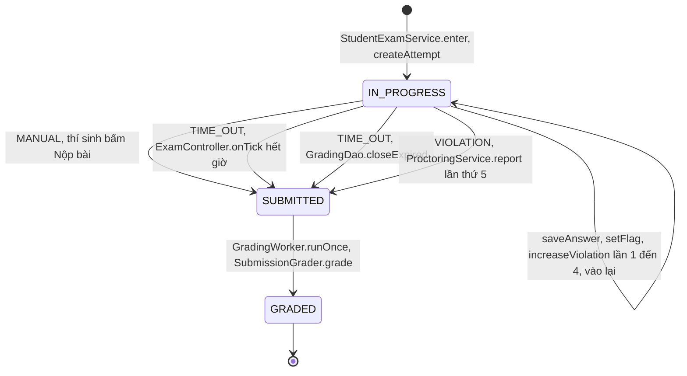

| `end_reason` | Ai gây ra | Đường đi trong mã | `submitted_at` |
|---|---|---|---|
| `MANUAL` | Thí sinh | `ExamController.onSubmit` → `submit(MANUAL)` → `StudentExamService.submit` → `StudentExamDao.markSubmitted` | `serverTime()` |
| `TIME_OUT` | Máy thí sinh, đồng hồ về 0 | `ExamController.onTick` → `submit(TIME_OUT)` → như trên | `serverTime()` |
| `TIME_OUT` | Máy chấm, ca đã qua giờ đóng | `GradingWorker.runOnce` → `GradingDao.closeExpired(now)` | `exam_session.close_time` |
| `VIOLATION` | Đủ 5 lần rời cửa sổ | `ProctoringService.report` → `ViolationPolicy.isTerminal` → `StudentExamService.submit(VIOLATION)` | `serverTime()` |

- Mọi lệnh chuyển sang `SUBMITTED` đều có `WHERE status = 'IN_PROGRESS'`, nên lệnh nào tới trước thắng, lệnh sau sửa 0
  dòng. `markSubmitted` khi đó trả `false` và `StudentExamService.submit` đọc lại trạng thái thật (`refresh`).
- `closeExpired` là lưới an toàn khi máy thí sinh tắt, mất mạng hoặc bị sửa: bài vẫn được nộp và chấm. Ghi
  `submitted_at = close_time` để bảng điểm phản ánh đúng BR-03, không phải lúc máy chấm chạy.
- `SUBMITTED → GRADED` chỉ có ở máy chấm (`oes_staff`). `trg_submission_client_update` chặn `oes_client` đặt `GRADED`,
  chặn sửa bài đã khỏi `IN_PROGRESS` và chặn giảm `violation_count`.
- Thoát ra vào lại không tạo bài mới: `enter` thấy bài `IN_PROGRESS` thì mở lại, thấy bài đã khóa thì ném
  `ALREADY_SUBMITTED`.
- Bài kết thúc do vi phạm vẫn được chấm phần đã làm như mọi bài khác.
- Nguồn: [oes/service/StudentExamService.java](../src/main/java/com/group2/oes/service/StudentExamService.java),
  [oes/service/GradingWorker.java](../src/main/java/com/group2/oes/service/GradingWorker.java),
  [oes/dao/jdbc/JdbcGradingDao.java](../src/main/java/com/group2/oes/dao/jdbc/JdbcGradingDao.java).

---

## Sơ đồ tuần tự

Lần theo mã thật, tên ghi dạng `Lớp.phương thức`. Mọi lời gọi từ controller xuống service chạy trong
`BackgroundTasks.run` (luồng nền); kết quả quay về luồng giao diện.

### Đăng nhập trên máy thí sinh

Thuộc phần 1. Máy thí sinh đọc `v_login`, không đọc `app_user`; tài khoản giảng viên, quản trị viên bị từ chối trước
khi kiểm tra mật khẩu vì khung nhìn không trả mã băm của họ. Các nhánh `alt` là lỗi: ngoại lệ về tới
`LoginController` và hiện bằng `ErrorDialogs`, luồng dừng ở đó.

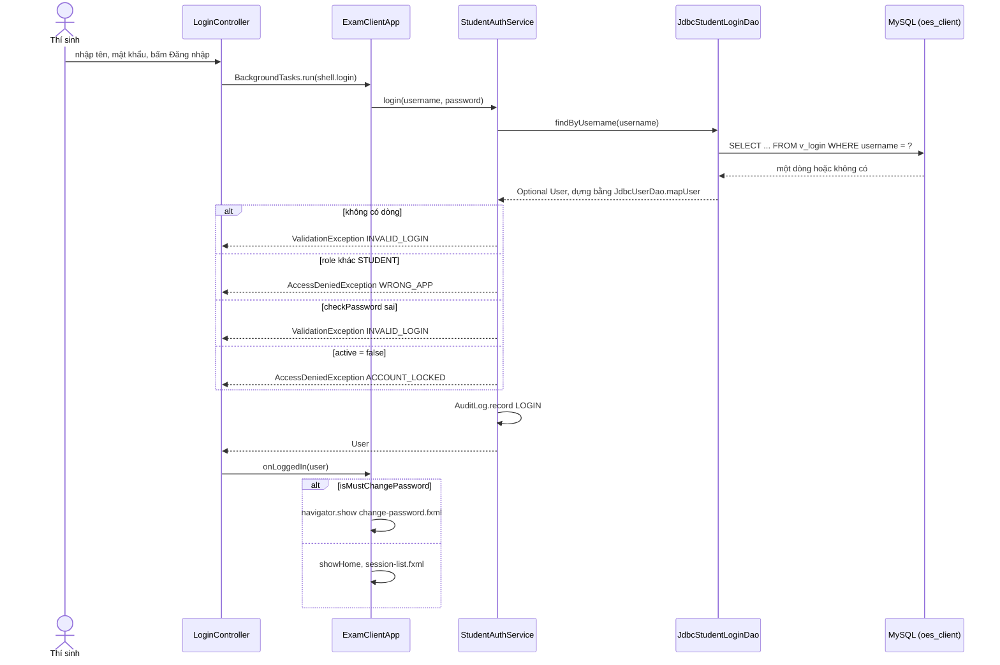

- Sai tên đăng nhập và sai mật khẩu báo cùng một câu, để người dò không biết tên nào có thật.
- `v_login` trả `password_hash` rỗng cho vai trò khác `STUDENT`, vì mật khẩu `oes_client` nằm trên mọi máy trạm; vẫn
  trả dòng để báo rõ "hãy dùng ứng dụng quản lý".
- Nguồn: [oes/service/StudentAuthService.java](../src/main/java/com/group2/oes/service/StudentAuthService.java),
  [oes/dao/jdbc/JdbcStudentLoginDao.java](../src/main/java/com/group2/oes/dao/jdbc/JdbcStudentLoginDao.java),
  [oes/ui/AppShell.java](../src/main/java/com/group2/oes/ui/AppShell.java).

### Vào thi

Thuộc phần 3. Thí sinh đọc quy chế ở `rules.fxml`, đánh dấu đồng ý rồi bấm Vào thi. `enter` hoặc tạo bài mới, hoặc
mở lại bài đang dở, rồi trộn đề theo seed của thí sinh. Các nhánh ném ngoại lệ dừng luồng tại đó.

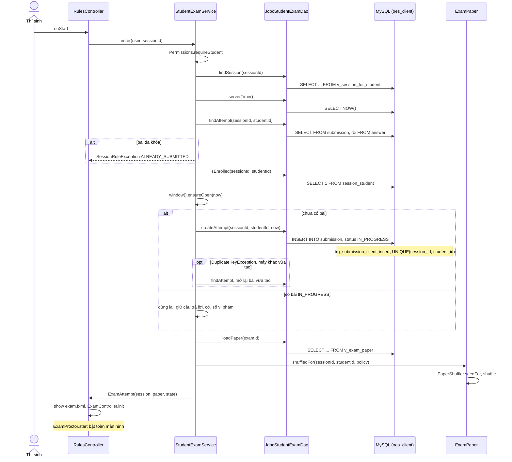

- Thứ tự kiểm tra: bài đã nộp (`ALREADY_SUBMITTED`) → chưa ghi danh (`NOT_ENROLLED`) → ngoài giờ
  (`SESSION_NOT_OPEN_YET` / `SESSION_CLOSED`). Kiểm tra bài đã nộp đứng đầu để thí sinh đã thi nhận đúng thông báo.
- Hai máy cùng đăng nhập một tài khoản và cùng bấm Vào thi: `UNIQUE(session_id, student_id)` chỉ cho một `INSERT`,
  `JdbcErrors` đổi lỗi 1062 thành `DuplicateKeyException`, `StudentExamService.create` mở lại bài của máy kia.
- Không lưu thứ tự đã trộn: lần sau vào lại tính ra đúng thứ tự cũ từ cùng seed.
- Nguồn: [oes/service/StudentExamService.java](../src/main/java/com/group2/oes/service/StudentExamService.java),
  [oes/ui/controller/RulesController.java](../src/main/java/com/group2/oes/ui/controller/RulesController.java),
  [oes/client/ExamPaper.java](../src/main/java/com/group2/oes/client/ExamPaper.java).

### Trả lời và tự lưu

Thuộc phần 3. Mỗi lần chọn đáp án hoặc gõ chữ, `AnswerSaver` chờ 500 ms rồi mới gửi; trigger trong CSDL kiểm tra lại
lần cuối bằng giờ máy chủ.

```mermaid
sequenceDiagram
    actor TS as Thí sinh
    participant EC as ExamController
    participant AS as AnswerSaver
    participant SVC as StudentExamService
    participant DAO as JdbcStudentExamDao
    participant DB as MySQL (oes_client)

    TS->>EC: chọn đáp án hoặc gõ chữ
    EC->>EC: onAnswer, AnswerSheet.setResponse
    EC->>AS: answerChanged(order, response)
    AS->>AS: debounce 500 ms, mỗi câu giữ giá trị mới nhất
    AS->>AS: flush, BackgroundTasks.run(drain)
    AS->>SVC: Sink.saveAnswer, saveAnswer(user, attempt, order, response)
    SVC->>SVC: writableState, requireOwn, isLocked, paper.contains
    SVC->>DAO: saveAnswer(submissionId, order, response)
    DAO->>DB: INSERT INTO answer ... ON DUPLICATE KEY UPDATE response = ?
    DB->>DB: trg_answer_client_insert hoặc _update
    alt bài IN_PROGRESS và close_time sau NOW()
        DB-->>DAO: OK
        SVC->>SVC: AttemptState.recordAnswer
        AS->>AS: offline = false, flush tiếp nếu còn
    else trigger SIGNAL 45000 SUBMISSION_LOCKED
        DAO-->>SVC: JdbcErrors, SessionRuleException
        AS->>EC: stop, onLocked
        EC->>EC: finishFromServer, sang result.fxml
    else mất kết nối, DataAccessException
        AS->>EC: offline = true, hiện dải vàng
        AS->>AS: thử lại sau 3 giây
    end
```

- Debounce 500 ms để gõ chữ ở câu điền khuyết không sinh hàng chục lượt ghi. Hàng đợi là `Map` theo số câu: đổi ý ba
  lần lúc mất mạng thì khi có mạng chỉ gửi lần cuối.
- Đánh dấu "xem lại" (`flagChanged`) gửi ngay không chờ, qua `setFlag` và cùng loại câu lệnh `ON DUPLICATE KEY UPDATE`.
- Câu trả lời ghi bằng `item_order` gốc, không phải vị trí trên màn hình.
- Kiểm tra ở service (`isLocked`) là để báo lỗi sớm; trigger là chốt chặn thật, vì giờ trên máy thí sinh không đáng tin.
- Nguồn: [oes/ui/AnswerSaver.java](../src/main/java/com/group2/oes/ui/AnswerSaver.java),
  [oes/ui/controller/ExamController.java](../src/main/java/com/group2/oes/ui/controller/ExamController.java),
  [db/security.sql](../db/security.sql).

### Rời cửa sổ và vi phạm

Thuộc phần 3. `ExamProctor` nghe ba sự kiện của cửa sổ (mất tiêu điểm, thoát toàn màn hình, thu nhỏ);
`ProctoringService` hỏi `ViolationPolicy` có gộp không, rồi tăng bộ đếm ngay trong câu `UPDATE`.

```mermaid
sequenceDiagram
    participant EP as ExamProctor
    participant EC as ExamController
    participant PS as ProctoringService
    participant VP as ViolationPolicy
    participant SVC as StudentExamService
    participant DAO as JdbcStudentExamDao
    participant DB as MySQL (oes_client)

    EP->>EP: focused false, fullScreen false hoặc iconified
    EP->>EC: onLeave(startWall + nanoTime đã trôi)
    alt đang gửi một lần khác
        EC->>EC: queuedLeave, gửi sau
    end
    EC->>PS: report(user, attempt, when)
    PS->>SVC: requireOwn(actor, attempt)
    PS->>VP: isMerged(lastCounted, when)
    alt cách lần được tính dưới 3 giây
        PS-->>EC: ViolationResult merged = true
    end
    PS->>DAO: increaseViolation(submissionId)
    DAO->>DB: UPDATE submission SET violation_count = LAST_INSERT_ID(violation_count + 1)
    Note over DB: WHERE id = ? AND status = 'IN_PROGRESS'
    DAO->>DB: SELECT LAST_INSERT_ID()
    DAO-->>PS: count
    alt count không đổi, bài đã khóa ở nơi khác
        PS->>SVC: refresh, đọc trạng thái thật
        PS-->>EC: ViolationResult theo trạng thái thật
    end
    PS->>VP: isTerminal(count)
    alt count bằng 5
        PS->>SVC: submit(actor, attempt, VIOLATION)
        PS-->>EC: ViolationResult terminated = true
        EC->>EC: finish, sang result.fxml
    else count dưới 5
        PS-->>EC: ViolationResult(count, remaining)
        EC->>EP: showDialog(cảnh báo lần N/5)
    end
```

- Thời điểm rời cửa sổ đo bằng `System.nanoTime()` từ một mốc lúc bắt đầu, nên chỉnh lùi giờ máy trạm không làm các
  lần sau bị coi là "sát nhau" và gộp mất.
- Tăng bằng `LAST_INSERT_ID(violation_count + 1)` thay vì đọc, cộng, ghi: hai sự kiện tới cùng lúc không mất lượt
  đếm, và `LAST_INSERT_ID` gắn với từng kết nối nên luồng khác không đọc nhầm.
- `lastCounted` chỉ cập nhật sau khi CSDL ghi xong: mất mạng thì `ExamController` giữ thời điểm gốc, 3 giây sau gửi
  lại, và lần gửi lại vẫn được đếm. Thí sinh cố ý ngắt mạng khi Alt+Tab vẫn bị tính.
- Hộp thoại của chính ứng dụng mở qua `ExamProctor.showDialog`: tạm ngừng nghe, chỉ nghe lại khi cửa sổ đã toàn màn
  hình và có tiêu điểm, nên cảnh báo không tự sinh thêm vi phạm.
- Nguồn: [oes/ui/ExamProctor.java](../src/main/java/com/group2/oes/ui/ExamProctor.java),
  [oes/service/ProctoringService.java](../src/main/java/com/group2/oes/service/ProctoringService.java),
  [oes/dao/jdbc/JdbcStudentExamDao.java](../src/main/java/com/group2/oes/dao/jdbc/JdbcStudentExamDao.java).

### Nộp bài

Thuộc phần 3. Máy thí sinh chỉ chuyển bài sang `SUBMITTED`, không chấm; màn hình kết quả hỏi lại CSDL mỗi 2 giây cho
tới khi máy chấm chấm xong (tối đa 60 giây, sau đó hiện nút Kiểm tra lại).

```mermaid
sequenceDiagram
    actor TS as Thí sinh
    participant EC as ExamController
    participant AS as AnswerSaver
    participant SVC as StudentExamService
    participant DAO as JdbcStudentExamDao
    participant RC as ResultController

    TS->>EC: bấm Nộp bài
    EC->>EC: ExamProctor.showDialog(xác nhận)
    EC->>EC: submit(MANUAL)
    EC->>AS: stop, ngừng tự gửi
    EC->>AS: drain, gửi hết câu còn chờ
    EC->>SVC: submit(user, attempt, MANUAL)
    SVC->>DAO: markSubmitted(id, MANUAL, serverTime)
    Note over DAO: UPDATE submission SET status = 'SUBMITTED' ...<br/>WHERE id = ? AND status = 'IN_PROGRESS'
    alt sửa 0 dòng, đã nộp ở máy khác hoặc máy chấm đã đóng ca
        SVC->>SVC: refresh, đọc trạng thái thật
    else sửa 1 dòng
        SVC->>SVC: AttemptState.markSubmitted, AuditLog SUBMIT_MANUAL
    end
    SVC-->>EC: AttemptState
    EC->>EC: finish, ExamProctor.stop
    EC->>RC: show result.fxml
    loop mỗi 2 giây, tối đa 30 lượt, tới khi isGraded
        RC->>SVC: refresh(user, sessionId)
    end
    RC->>SVC: review(user, sessionId)
    SVC->>DAO: loadReview, đọc v_exam_paper, answer, v_review
```

- Mất mạng lúc nộp: `submit` thử lại sau 3 giây, bài không mất. Ca đã đóng trong lúc `drain` thì câu chưa lưu kịp bị
  trigger từ chối (BR-04), phần đã lưu vẫn được nộp.
- Nộp hai lần giữ lần đầu: `StudentExamService.submit` trả ngay nếu `state.isLocked()`, và câu `UPDATE` có điều kiện
  `status = 'IN_PROGRESS'`.
- Hết giờ trên máy thí sinh đi cùng đường này với `EndReason.TIME_OUT` (gọi từ `ExamController.onTick`).
- Nguồn: [oes/ui/controller/ExamController.java](../src/main/java/com/group2/oes/ui/controller/ExamController.java),
  [oes/ui/controller/ResultController.java](../src/main/java/com/group2/oes/ui/controller/ResultController.java).

### Máy chấm chấm bài

Thuộc phần 4. `GradingScheduler` gọi `GradingWorker.runOnce` 3 giây một lần trên luồng `grading-worker`; mỗi lượt
đóng các ca quá giờ rồi chấm mọi bài `SUBMITTED`.

```mermaid
sequenceDiagram
    participant GS as GradingScheduler
    participant GW as GradingWorker
    participant GD as JdbcGradingDao
    participant SG as SubmissionGrader
    participant DB as MySQL (oes_staff)

    loop mỗi 3 giây, scheduleWithFixedDelay
        GS->>GW: runOnce()
        GW->>DB: ExamSessionDao.serverTime, SELECT NOW()
        GW->>GD: closeExpired(now)
        GD->>DB: UPDATE submission JOIN exam_session, status SUBMITTED, end_reason TIME_OUT
        Note over DB: submitted_at = close_time, WHERE close_time ≤ now
        GW->>GD: findSubmittedIds()
        GD->>DB: SELECT id FROM submission WHERE status = 'SUBMITTED'
        loop mỗi bài
            GW->>GD: load(id)
            GD->>DB: đọc submission, answer, ExamSessionDao.findById
            GW->>SG: grade(submission)
            SG->>SG: mỗi ExamItem: Exam.strategyFor, Answer.grade
            SG->>SG: Submission.markGraded(tổng làm tròn 2 chữ số)
            GW->>GD: saveGrades(submission)
            GD->>DB: transaction, UPDATE submission SET status, total_score
            Note over DB: WHERE id = ? AND status = 'SUBMITTED'
            GD->>DB: INSERT INTO answer ... ON DUPLICATE KEY UPDATE earned_point
        end
        GW-->>GS: RunResult(closed, graded, failed)
    end
```

- Chỉ máy chấm đọc đáp án (qua `ExamSession` → `Exam` → `Question`), bằng `oes_staff`. Máy thí sinh không bao giờ
  chấm (NFR-04).
- `saveGrades` chạy trong một giao dịch và có điều kiện `status = 'SUBMITTED'`: máy chấm khác đã chấm trước thì câu
  lệnh sửa 0 dòng, giao dịch dừng, không ghi đè.
- Câu bỏ trống chưa có dòng trong `answer` thì được thêm dòng `response = NULL` để thống kê đếm đủ số câu.
- Lỗi riêng một bài: bỏ qua bài đó, lượt sau thử lại, chỉ ghi stack trace lần đầu. Lỗi kết nối
  (`DataAccessException`): dừng cả lượt. `GradingScheduler.runNow` bắt mọi ngoại lệ vì
  `ScheduledExecutorService` sẽ lặng lẽ ngừng lặp nếu một lượt ném ra ngoài.
- Nguồn: [oes/service/GradingScheduler.java](../src/main/java/com/group2/oes/service/GradingScheduler.java),
  [oes/service/GradingWorker.java](../src/main/java/com/group2/oes/service/GradingWorker.java),
  [oes/grading/SubmissionGrader.java](../src/main/java/com/group2/oes/grading/SubmissionGrader.java),
  [oes/dao/jdbc/JdbcGradingDao.java](../src/main/java/com/group2/oes/dao/jdbc/JdbcGradingDao.java).

### Sinh đề theo ma trận

Thuộc phần 2. Ngân hàng câu hỏi của môn đã được nạp khi giảng viên chọn môn (`QuestionBankService.loadBank`); bốc câu
diễn ra trong bộ nhớ, CSDL chỉ nhận đề hoàn chỉnh.

```mermaid
sequenceDiagram
    actor GV as Giảng viên
    participant EBC as ExamBuilderController
    participant ES as ExamService
    participant QB as QuestionBank
    participant EX as Exam
    participant DAO as JdbcExamDao
    participant DB as MySQL (oes_staff)

    GV->>EBC: nhập ma trận, điểm mỗi câu, bấm Tạo đề
    EBC->>EBC: readMatrix, ExamMatrix.add từng dòng
    EBC->>ES: generate(user, bank, title, policy, matrix, pointEach, new Random())
    ES->>ES: Permissions.requireManage(actor, bank.getSubject())
    ES->>QB: pick(matrix, random)
    QB->>QB: findShortages(matrix)
    alt có ô thiếu câu
        QB-->>EBC: ValidationException BANK_SHORTAGE
    end
    QB-->>ES: danh sách câu đã bốc
    ES->>EX: Exam.draft(title, subject, policy)
    loop mỗi câu
        ES->>EX: addItem(q, pointEach)
    end
    ES->>EX: validateForUse()
    ES->>DAO: insert(exam)
    DAO->>DB: transaction, INSERT INTO exam, INSERT INTO exam_item từng câu
    ES->>ES: AuditLog GENERATE_EXAM
    ES-->>EBC: Exam
```

- Mọi câu sinh theo ma trận cùng một mức điểm (`pointEach`); muốn điểm khác nhau thì tạo đề thủ công
  (`ExamService.createManual`).
- `validateForUse` sau khi thêm câu chặn trường hợp ma trận rỗng sinh đề 0 câu (BR-11), giống `createManual`.
- Đề mới luôn chưa khóa (`Exam.draft`, `version = 1`); chỉ khóa khi mở ca thi đầu tiên.
- Nguồn: [oes/service/ExamService.java](../src/main/java/com/group2/oes/service/ExamService.java),
  [oes/ui/controller/ExamBuilderController.java](../src/main/java/com/group2/oes/ui/controller/ExamBuilderController.java),
  [oes/model/QuestionBank.java](../src/main/java/com/group2/oes/model/QuestionBank.java).

### Mở ca thi

Thuộc phần 3. Giảng viên chọn đề, giờ mở, giờ đóng, cấu hình trộn và danh sách thí sinh; mở ca xong thì đề bị khóa.

```mermaid
sequenceDiagram
    actor GV as Giảng viên
    participant SFC as SessionFormController
    participant SS as ExamSessionService
    participant SD as JdbcExamSessionDao
    participant ED as JdbcExamDao
    participant DB as MySQL (oes_staff)

    GV->>SFC: chọn lớp, thí sinh, giờ, cấu hình, bấm Lưu
    SFC->>SFC: new SessionWindow(open, close), new SessionPolicy(...)
    SFC->>SS: createSession(user, exam, window, policy, students)
    SS->>SS: Permissions.requireManage(actor, exam.getSubject())
    SS->>SS: kiểm tra NO_STUDENTS
    SS->>SD: serverTime()
    SS->>SS: kiểm tra SESSION_IN_PAST
    SS->>SS: new ExamSession(0, exam, window, policy), exam.validateForUse
    SS->>SS: enrollAll(students)
    SS->>SD: insert(session)
    SD->>DB: transaction, INSERT INTO exam_session, INSERT INTO session_student
    opt đề chưa khóa
        SS->>SS: exam.lock()
        SS->>ED: lock(examId)
        ED->>DB: UPDATE exam SET locked = TRUE WHERE id = ?
    end
    SS->>SS: AuditLog CREATE_SESSION
    SS-->>SFC: ExamSession
```

- `SessionWindow` từ chối giờ đóng không sau giờ mở ngay khi tạo (`SESSION_TIME`); CSDL kiểm tra lại bằng
  `CHECK (close_time > open_time)`.
- `SESSION_IN_PAST` so với giờ máy chủ, không so với đồng hồ máy giảng viên.
- Khóa đề (BR-09) vì bài làm tham chiếu tới câu theo `item_order` của đề: sửa đề sau khi đã có ca thì kết quả thi đã
  có bị đổi nghĩa. Muốn sửa thì `ExamService.newVersion`.
- Ghi danh theo lớp: `createSessionForClass` kiểm tra lớp học đúng môn của đề (`CLASS_WRONG_SUBJECT`) rồi gọi
  `createSession` với `studentsOfClass`.
- Nguồn: [oes/service/ExamSessionService.java](../src/main/java/com/group2/oes/service/ExamSessionService.java),
  [oes/ui/controller/SessionFormController.java](../src/main/java/com/group2/oes/ui/controller/SessionFormController.java),
  [oes/dao/jdbc/JdbcExamSessionDao.java](../src/main/java/com/group2/oes/dao/jdbc/JdbcExamSessionDao.java).

---

## Use case tổng quát

Cả bốn phần; mỗi khung con là một phần phân công. Tên và tác nhân lấy từ bảng use case trong [PLAN.md](PLAN.md).
Mermaid không có sơ đồ use case chuẩn nên vẽ bằng flowchart: hình chữ nhật là tác nhân, hình viên thuốc là use case,
khung ngoài là ranh giới ứng dụng. Tách hai sơ đồ theo ứng dụng; UC-03, UC-04, UC-17 có ở cả hai vì mỗi ứng dụng cài
đặt riêng.

```mermaid
flowchart LR
    AD["Quản trị viên"]
    GV["Giảng viên"]

    subgraph STAFF["StaffApp"]
        subgraph P1["Phần 1"]
            UC01(["UC-01 Quản lý tài khoản người dùng"])
            UC02(["UC-02 Phân quyền người dùng"])
            UC03(["UC-03 Đăng nhập / Đăng xuất"])
            UC04(["UC-04 Cập nhật hồ sơ, đổi mật khẩu"])
            UC05(["UC-05 Quản lý môn học và lớp học phần"])
        end
        subgraph P2["Phần 2"]
            UC06(["UC-06 Quản lý ngân hàng câu hỏi"])
            UC07(["UC-07 Nhập câu hỏi từ tệp"])
            UC08(["UC-08 Tạo đề thi"])
            UC09(["UC-09 Sinh đề theo ma trận"])
        end
        subgraph P3["Phần 3"]
            UC10(["UC-10 Lập lịch và cấu hình ca thi"])
            UC11(["UC-11 Ghi danh thí sinh"])
        end
        subgraph P4["Phần 4"]
            UC17(["UC-17 Xem kết quả và thống kê"])
            UC18(["UC-18 Xuất bảng điểm CSV"])
        end
    end

    AD --- UC01
    AD --- UC02
    AD --- UC03
    AD --- UC04
    AD --- UC05
    GV --- UC03
    GV --- UC04
    GV --- UC05
    GV --- UC06
    GV --- UC07
    GV --- UC08
    GV --- UC09
    GV --- UC10
    GV --- UC11
    GV --- UC17
    GV --- UC18
```

```mermaid
flowchart LR
    TS["Thí sinh"]
    CLK["Đồng hồ hệ thống<br/>(máy chấm)"]

    subgraph CLIENT["ExamClientApp và máy chấm"]
        subgraph Q1["Phần 1"]
            UC03(["UC-03 Đăng nhập / Đăng xuất"])
            UC04(["UC-04 Cập nhật hồ sơ, đổi mật khẩu"])
        end
        subgraph Q3["Phần 3"]
            UC12(["UC-12 Xem danh sách ca thi"])
            UC13(["UC-13 Vào ca thi"])
            UC14(["UC-14 Làm bài thi"])
            UC15(["UC-15 Ghi nhận vi phạm quy chế"])
        end
        subgraph Q34["Phần 3 nộp, phần 4 chấm"]
            UC16(["UC-16 Nộp bài và chấm tự động"])
        end
        subgraph Q4["Phần 4"]
            UC17(["UC-17 Xem kết quả và thống kê"])
        end
    end

    TS --- UC03
    TS --- UC04
    TS --- UC12
    TS --- UC13
    TS --- UC14
    TS --- UC15
    TS --- UC16
    TS --- UC17
    CLK --- UC16
```

- Thí sinh chỉ dùng ExamClientApp; quản trị viên và giảng viên dùng StaffApp. Tài khoản giảng viên đăng nhập ứng dụng
  thi bị từ chối (`WRONG_APP`).
- "Đồng hồ hệ thống" là tác nhân phụ của UC-16: `GradingWorker` tự nộp bài khi ca quá giờ đóng và tự chấm, không cần
  ai bấm. Nửa "nộp" thuộc phần 3, nửa "chấm" thuộc phần 4.
- UC-15 không do thí sinh chủ động gọi; nó xảy ra khi thí sinh rời cửa sổ trong lúc làm bài (UC-14).
- UC-17 phía giảng viên là bảng điểm và thống kê của ca (`StatisticsService`); phía thí sinh là điểm và xem lại bài
  (`StudentExamService.review`).
- Hai luồng ngoại lệ chưa làm: UC-08 5a (đổi một câu trong bản xem trước đề) và UC-13 3a (không vào được toàn màn
  hình thì không cho thi).
- Nguồn: [PLAN.md](PLAN.md), [manual-test-checklist.md](manual-test-checklist.md), [PHAN-CONG.md](PHAN-CONG.md).
